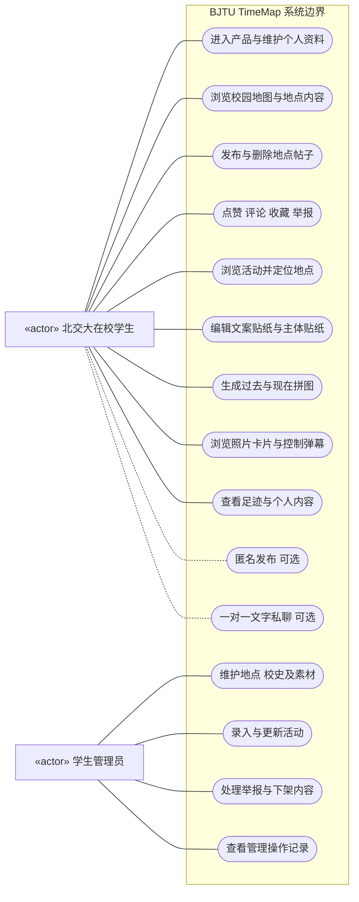
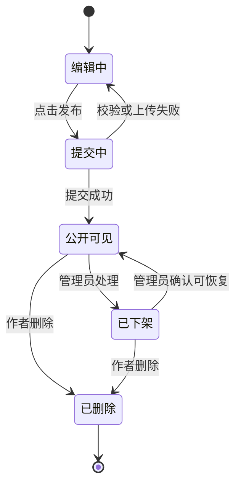
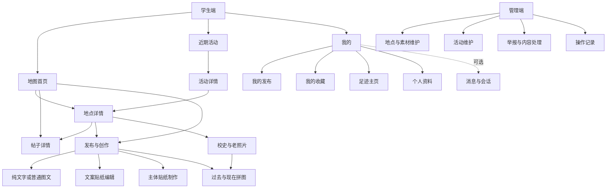
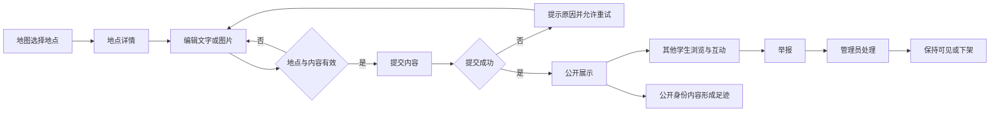

# BJTU TimeMap 需求分析与产品设计文档

面向北京交通大学在校学生的校园地点内容与记忆共创平台

| 文档信息 | 内容 |
| --- | --- |
| 课程作业 | 需求分析和产品设计文档 |
| 项目名称 | BJTU TimeMap 北交大校园记忆地图 |
| 文档版本 | V1.0 需求评审版 |
| 编写日期 | 2026 年 9 月 20 日 |
| 项目团队 | 第二组，成员姓名及 GitHub 账号待补充 |
| 产品形态 | 优先微信小程序，手机网页作为备用交付方案，管理端采用网页 |
| MVP 截止时间 | 2026 年 10 月 16 日上课前 |
| 文档用途 | 课程作业、需求评审、原型设计、任务分工与版本验收 |

本文将课程约束、初版需求分析、开题答辩材料及后续讨论整合为可实施的产品需求。项目以预设校园地点组织内容，支持学生浏览校园记忆、发现近期活动、发布文字与图片，并逐步加入照片卡片、主体贴纸、文字弹幕和校园足迹等特色体验。

本学期承诺完成全部基础核心功能与特色功能；匿名发布和一对一私聊属于优先可选扩展，不构成本学期必交承诺。活动搭子与个性化推荐优先级更低，课表、二手交易等不进入本期计划。

**状态说明：**“已确认”表示已在需求讨论中确定；“建议”表示本版给出的设计或排期方案，需经团队评审后冻结；“待补充”表示尚缺实际资料。文中的性能指标、数量限制、算法参数和迭代分配属于建议目标，不代表已经实现或通过测试。

## 目录

1. [项目背景与业务问题](#1-项目背景与业务问题)
2. [用户角色与需求](#2-用户角色与需求)
3. [产品范围与版本优先级](#3-产品范围与版本优先级)
4. [功能需求与业务规则](#4-功能需求与业务规则)
5. [产品结构与界面交互设计](#5-产品结构与界面交互设计)
6. [用户故事与验收标准](#6-用户故事与验收标准)
7. [非功能需求与数据设计](#7-非功能需求与数据设计)
8. [项目计划人员分工与风险预估](#8-项目计划人员分工与风险预估)
9. [附录](#附录)

---

## 1 项目背景与业务问题

### 1.1 项目背景

校园中的地标、建筑、食堂和公共空间承载着学生的日常生活与共同记忆。学生可能希望了解某处建筑的历史、查看某个食堂近期的分享、寻找在某地点举办的活动，或把自己的校园故事留在对应位置。

本项目以北京交通大学校内地点为组织单位，将校史与老照片、学生记忆、近期活动和日常分享集中到地图中。学生从地点进入内容，也可以通过内容回到地点，使校园空间与学生创作建立持续联系。

项目定位为课程实训中的新开发项目。Campus 的地图照片展示与图片创作思路作为交互参考，需在文档和 GitHub README 中标注；本项目独立实现代码、组织校园内容，不复制第三方素材或数据。

### 1.2 业务问题与需求假设

下表是基于项目材料提出的待验证问题，不等同于已经完成的用户调研结论。

| 业务问题 | 典型情境 | 产品响应 | 后续验证方式 |
| --- | --- | --- | --- |
| 地点相关内容缺少统一入口 | 想了解一个地点，需要分别查找介绍、照片、帖子和活动 | 以地点详情聚合不同类型内容 | 让学生完成指定地点的信息查找任务 |
| 校园记忆缺少直观的空间关联 | 分享照片后难以形成可回顾的校园经历 | 帖子关联地点，公开发布形成足迹 | 访谈学生是否愿意通过地点回顾自己的内容 |
| 近期活动不容易及时发现 | 看到了活动信息，却不知道时间、举办地点或是否结束 | 提供近期活动列表及地点关联 | 测试学生能否找到适合时间的校内活动 |
| 普通发帖的表达方式有限 | 希望通过有校园特色的图片表达心情和经历 | 文案贴纸、主体贴纸和新老照片拼图 | 比较不同创作入口的完成率与使用意愿 |
| 地图帖子过多可能难以浏览 | 照片遮挡、文字过多、旧内容占据显著位置 | 分级展开、展示数量控制、弹幕开关与近期排序 | 在不同内容密度下进行可用性测试 |

### 1.3 产品定位与价值

**产品定位：**面向北京交通大学在校学生，以校内预设地点为入口，连接校园记忆、近期热点和活动，并支持图片创作与个人足迹沉淀的内容共创地图。

核心价值包括：

- **地点内容聚合：**在同一地点查看介绍、历史照片、学生分享和近期活动。
- **校园表达与记忆：**通过纯文字、图文和主体贴纸表达经历，并形成可回顾的校园足迹。
- **近期信息发现：**通过地点热帖、食堂标签与活动列表发现具有时效性的校园内容。
- **持续共创：**由学生贡献内容，管理员维护基础资料并处理举报，形成可持续运营的课程项目。

### 1.4 课程约束与交付目标

| 约束 | 项目落实方式 | 交付或核验材料 |
| --- | --- | --- |
| 场景限于北交大校内 | 首版覆盖海淀校区约 8—12 个预设地点，包含食堂；后续可扩展东校区 | 地点清单、地图演示 |
| 业务用户为北交大在校学生 | 招募与试用范围限定在校学生，管理职责由团队学生成员承担 | 试用方案、低敏去重记录 |
| 不接入或爬取敏感数据，不采集真实密码、身份证等 | 采用最小必要信息、人工整理或获准使用的内容，不对接教务密码 | 数据字段清单、来源登记 |
| 第 5 周前上线可运行原型 | 2026 年 10 月 16 日上课前完成部署和核心流程验收 | 可访问入口、版本记录 |
| 第 6—15 周至少 3 轮迭代 | 按第 6—8、9—11、12—15 周组织迭代 | 发布说明、缺陷及反馈闭环 |
| 至少 50 名真实北交大学生试用 | 分阶段招募、去重统计、安排明确体验任务 | 匿名反馈、任务结果与统计 |
| GitHub 开源且为新开发项目 | 保留开发历史、参考说明、运行文档和贡献记录 | 仓库地址、README、提交与 PR |
| 原则上 5 人一组，第 2 周上课前提交分组表 | 补齐成员与 GitHub Contributors 对应关系 | 分组表、账号映射 |
| 飞书协作全程留痕 | 建立群、云文档、多维表格、会议纪要与验收记录 | 飞书索引页 |
| 第 4、8、12、16 周贡献度确认 | 依据可核验交付协商记录；建议范围 5%—35%，特殊贡献说明原因 | 各期贡献度确认表 |

课程要求日期优先于建议排期；除已给出的 MVP 日期外，其他教学周与自然日期的对应关系需根据课程日历核对。

### 1.5 成功标准

项目首先以“能真实使用、内容流程完整、符合课程交付”为成功标准，而非单纯以功能数量衡量。

1. 学生可以完成地图浏览、地点查看、发帖、互动和举报，管理员可以处理内容问题。
2. 全部基础和特色功能在本学期按计划完成并留下验收证据。
3. 至少 50 名去重后的真实北交大学生完成实际试用，反馈能对应到改进记录。
4. GitHub 与飞书中可以追溯需求、任务、实现、测试、发布及成员贡献。
5. 具体使用率、满意度和任务完成率在试用后报告真实结果，不提前写成已达成指标。

## 2 用户角色与需求

### 2.1 用户角色

| 角色 | 定义 | 主要需求 | 权限边界 |
| --- | --- | --- | --- |
| 普通学生 | 参与项目使用的北交大在校学生 | 浏览、发布、互动、创作图片、查看自己的记录与足迹 | 管理自己的内容，不能处理他人内容或查看匿名作者身份 |
| 学生管理员 | 承担内容维护职责的团队成员 | 维护地点与活动、处理举报、下架不当内容、维护素材 | 仅授权账号可以进入管理端，关键操作留痕 |

浏览者、发布者、评论者是同一类学生在不同操作中的行为，不单独建立互斥的身份体系。管理员同时可以使用普通学生功能。校友、教师、社会访客不作为本项目业务用户角色，教师和助教属于课程评审与协作参与者。

### 2.2 典型需求与使用场景

| 场景编号 | 学生或管理员的目标 | 典型流程 | 需求关联 |
| --- | --- | --- | --- |
| SC-01 | 了解一个校园地点 | 打开地图，选择地点，查看简介、老照片和帖子 | F02、F03 |
| SC-02 | 留下校园经历 | 从地点发起发布，输入文字或上传图片，提交后查看 | F04 |
| SC-03 | 发现食堂近期分享 | 进入食堂，按标签、最新或热门浏览，收藏内容 | F05、F08 |
| SC-04 | 了解近期活动 | 查看活动列表、时间和来源，定位举办地点 | F06 |
| SC-05 | 创作校园图片 | 选图，添加文案或提取主体，保存并发布 | F10、F11 |
| SC-06 | 对比校园变化 | 选择同地点新老照片，生成带年份的拼图 | F12 |
| SC-07 | 回顾校园足迹 | 进入个人主页，查看发布过内容的地点和帖子 | F14 |
| SC-08 | 处理不当内容 | 学生举报，管理员判断，必要时下架并记录原因 | F07 |

### 2.3 系统用例图

下图以用例椭圆和角色关联线表达系统边界。普通关联线表示角色可参与用例；虚线连接表示可选扩展，不表示功能已经上线。管理员作为学生也具备普通学生用例，图中不重复连线。



### 2.4 学生身份与访问范围

微信登录仅提供应用账号识别，不能直接证明在校学生身份。首版建议通过团队面向校内学生定向招募、线下确认和邀请码控制试用范围，不收集身份证照片、教务密码或学籍证明图片。

学生准入方案在开发前评审。若只采用邀请码，应说明其属于受控试用措施，不能宣称已经实现严格学籍认证。管理员权限由团队明确授予，不允许普通学生自行切换角色。

## 3 产品范围与版本优先级

### 3.1 范围基线

以下内容已确认：

- 微信小程序优先，手机网页作为备用交付方案；队内已有小程序上线经验。
- 首版采用海淀校区约 8—12 个预设地点，包含食堂；不允许任意选点发布。
- 全部基础核心功能与特色功能在本学期完成，具体迭代分配由团队评审。
- 支持点赞、评论、收藏；热度算法尚未确定。
- 首版帖子与评论直接发布，不逐条人工预审；保留举报、管理入口和事后下架能力。
- 活动由管理员整理录入，学生投稿不进入首版。
- 足迹由公开身份发布内容的地点形成；匿名内容不进入公开足迹。
- 图片创作包括文案贴纸、自动主体抠图贴纸和同地点新老照片拼图。
- 匿名发布必须关联地点；私聊不从匿名作者入口发起。

### 3.2 优先级定义

| 标识 | 含义 | 交付承诺 |
| --- | --- | --- |
| P0 | 建议纳入 MVP 的基础能力 | 保障 10 月 16 日前核心流程可运行 |
| P1 | 本学期必须完成的特色功能 | 纳入至少 3 轮迭代，并逐项验收 |
| P2 | 优先可选扩展 | 核心与特色按期完成且有余力后再立项 |
| P3 | 低优先级方向 | 保留需求，不占当前迭代承诺 |
| 不纳入 | 本期明确不规划 | 不进入开发任务列表 |

P0 和 P1 的具体拆分为本版建议；“本学期全部完成基础与特色”的承诺已确认。不得以 P2 扩展替代尚未完成的 P1 功能。

### 3.3 功能与版本矩阵

| 编号 | 功能 | 优先级 | 建议首次交付 | 核心验收结果 |
| --- | --- | --- | --- | --- |
| F01 | 学生访问与个人资料 | P0 | MVP | 可识别本人，管理端有独立权限 |
| F02 | 校园地图与预设地点 | P0 | MVP | 约 8—12 个有效地点，可进入详情 |
| F03 | 地点详情 校史 老照片 | P0 | MVP | 地点基础信息和素材来源可查看 |
| F04 | 纯文字与图文发布 | P0 | MVP | 必须关联地点，提交成功后直接展示 |
| F05 | 点赞 评论 收藏 | P0 | MVP | 可操作、可撤销相应互动，计数一致 |
| F06 | 近期活动 | P0 | MVP | 管理员录入，学生浏览并定位地点 |
| F07 | 举报与内容管理 | P0 | MVP | 举报进入待处理列表，可下架并留痕 |
| F08 | 地点及食堂热帖 | P1 | 迭代一 | 最新和近期热门可切换，规则可说明 |
| F09 | 地图照片卡片与轮换 | P1 | 迭代一 | 地点聚合、放大展开、点击帖子一致 |
| F10 | 文案贴纸编辑 | P1 | 迭代二 | 可编辑文字、变换贴纸、保存和发布 |
| F11 | 主体贴纸制作与地图展示 | P1 | 迭代二 | 自动抠图、透明展示、头像及发布用途可用 |
| F12 | 过去与现在拼图 | P1 | 迭代二 | 同地点双图、年份、布局、保存发布可用 |
| F13 | 纯文字帖子弹幕 | P1 | 迭代一 | 对应真实文字帖，可关闭，点击到详情 |
| F14 | 校园足迹主页 | P1 | 迭代三 | 按公开有效帖子关联地点聚合 |
| F15 | 地点帖子匿名发布 | P2 | 条件满足后立项 | 身份隐藏且不从足迹、回复或入口泄露 |
| F16 | 一对一文字私聊 | P2 | 条件满足后立项 | 公开身份进入，可屏蔽、举报和查看记录 |
| F17 | 活动搭子或想参加 | P3 | 不排固定版本 | 先验证需求，再确定是否实现 |
| F18 | 个性化推荐 | P3 | 不排固定版本 | 不与基础热门排序混同 |

### 3.4 MVP 最小可运行范围

MVP 包含学生访问、基础地图标记、地点详情、校史和老照片浏览、纯文字及普通图文发布、点赞评论收藏、近期活动、个人发布记录和管理端举报处理。地图在 MVP 可以先采用基础点位与地点内容面板，Campus 风格的照片叠放与透明贴纸展示按 P1 迭代完成。

建议首批内容准备约 8—12 个地点、至少 3 组可用于后续拼图的同地点新老照片素材，并整理若干有可靠来源的校内活动。以 5 条活动作为准备目标；若届时不足 5 条真实有效活动，应如实展示可确认内容，演示数据必须明确标注，不得伪装成实际活动。

MVP 上线验收至少覆盖一个完整流程：学生发布内容后在对应地点可见；其他学生能互动、举报；管理员处理后，地点列表和帖子详情同步更新。

### 3.5 范围外事项与备用方案

本期不开发课表、教务查询、二手交易、支付交易、群聊、好友体系、跨校社区、校外地图内容、连续轨迹采集和独立下载安装 App。校庆祝福可作为校园记忆的内容主题，不单独承诺一套专题系统。

手机网页是小程序交付受阻时的备用方案，不等同于无成本自动转换。第 3 周结束前建议由小程序负责人核对账号、发布路径和地图能力；存在无法按期消除的阻塞时，立即评估网页核心流程交付，明确额外适配任务。无论采用哪种载体，都应保持核心业务规则和课程数据约束。

## 4 功能需求与业务规则

### 4.1 账号与个人资料 F01

首版建议通过小程序登录获得项目内账号，用户设置项目内昵称和头像。不采集微信、教务或其他真实账号密码，不要求填写身份证、手机号等与核心功能无关的信息。

个人中心提供“我的发布”“我的收藏”和个人资料入口；后续增加足迹主页。本人可以管理自己的内容，不能修改其他用户的内容。会话过期时提示重新进入，保留尚未提交的本地编辑内容属于建议增强。

学生准入、昵称规范、账号停用与资料删除处理流程需在上线前明确。头像由主体贴纸设置时，仅更新本项目头像，不修改微信头像。

### 4.2 地图与地点详情 F02 F03

**地点规则：**地点由管理员预先维护，具有唯一编号、名称、分类、地图坐标、简介和启用状态。建议类别包括校园地标、教学空间、生活空间、食堂等，实际分类以首批清单为准。

学生进入地图后默认展示首发校园范围，不依赖精确实时定位即可使用。点击地点可以查看简介、校史、老照片、学生帖子和关联活动。从地点进入发布页时自动带入地点，提交前允许更换为其他启用地点。

**地点详情信息：**

| 信息区域 | 内容 | 行为 |
| --- | --- | --- |
| 基础资料 | 名称、分类、简介、封面 | 返回地图并保持原浏览区域 |
| 历史与照片 | 校史说明、照片年代、来源 | 查看大图，进入拼图创作 |
| 学生内容 | 纯文字、图文、主体贴纸帖子 | 切换最新或热门，进入详情 |
| 近期活动 | 标题、时间、状态 | 进入活动详情 |
| 发布入口 | 当前地点名称 | 默认关联当前地点 |

没有帖子时显示地点基础信息和发布引导，不能出现空白页面。地点停用后不允许新帖关联；已有帖子保留地点名称并标注停用状态，不能因删除地点记录而丢失历史关联。正式地点清单和资料由团队核实，不把示例地点直接视为已经准备完毕。

### 4.3 发布与内容状态 F04

帖子包含纯文字、普通图文和主体贴纸三种内容形式；匿名是独立发布选项，不是第四种内容类型。F15 未上线前不显示可用的匿名开关。

| 字段 | 规则 |
| --- | --- |
| 关联地点 | 必填，只能选择管理员启用的预设地点 |
| 正文 | 纯文字帖必填；图片帖可选，建议上限 1,000 字 |
| 图片 | 普通图文建议 1—3 张；主体贴纸首版建议 1 张透明图 |
| 标签 | 可选；食堂可使用推荐、避雷、排队等标签 |
| 内容形式 | 根据发布入口与媒体确定，不以匿名状态区分 |
| 作者与时间 | 由系统记录，不允许普通用户伪造其他作者 |

字数、图片数量、单图大小和标签数量为建议限制，开发前统一冻结并在页面提示。纯空白文字且无图片时不得提交；图片上传失败时不得创建缺少必要媒体的成功帖子。重复点击发布不得生成重复内容，失败后可重试。

**首版实行直接发布、事后处理。** 发布成功后进入公开展示，不设置人工审核等待环节。举报记录与帖子可见状态分别管理，避免将“被举报”等同于“违规”。



恢复功能为建议管理能力，必须有原因记录，不能自动恢复已确认违规内容。MVP 建议暂不支持修改已发布正文和媒体，作者可删除后重新发布，避免编辑流程扩大首版范围。

### 4.4 点赞评论收藏 F05

- **点赞：**同一账号对同一帖子只能保留一个有效点赞，再次操作可取消。页面计数与本人状态保持一致。
- **评论：**首版建议采用一级评论列表，支持发布与删除自己的评论，不强制建设多级回复树。评论直接展示，也可单独举报和下架。建议每条最多 300 字。
- **收藏：**同一账号可收藏或取消收藏帖子，在“我的收藏”查看；收藏名单不公开。帖子删除或下架后显示不可用提示或从有效列表移除，不继续展示受限内容。
- **权限：**学生只能删除自己的帖子与评论。前端隐藏按钮之外，服务端也需检查身份和操作权限。
- **计数：**已删除或下架的评论不计入有效评论量；重复请求不重复增加互动计数。

### 4.5 近期活动 F06

管理员录入活动标题、简介、起止时间、关联地点、主办方、信息来源、参与方式和更新时间。活动必须发生在项目范围内；首版建议一项活动关联一个预设地点。

活动列表默认按即将开始时间排序，支持“近期全部”“今天”“本周”等简单筛选。活动详情可以返回或定位举办地点，地点详情也可以进入相关活动。基础活动推荐采用时间排序与管理员精选，不依赖个性化算法。

| 状态 | 判定或操作 | 展示方式 |
| --- | --- | --- |
| 即将开始 | 未到开始时间 | 出现在近期列表 |
| 进行中 | 当前时间位于起止区间 | 显示进行中标记 |
| 已结束 | 超过结束时间 | 退出近期列表，可保留地点历史入口 |
| 已取消 | 管理员确认取消 | 详情明显标注，停止作为正常活动推荐 |

来源或时间不明确时不直接作为真实活动发布；改期或更换地点后应更新记录。首版不提供活动报名系统、代报名、付费或票务功能。学生投稿属于后续候选，不占用 MVP 必交范围。

### 4.6 举报与管理端 F07

学生可对帖子与评论举报，选择原因并补充说明。建议原因包括不当内容、隐私泄露、侵权、广告刷屏、信息错误和其他。同一用户对同一对象的未结举报合并或限制重复提交。

举报提交成功后进入管理端待处理列表，不自动隐藏被举报内容。管理员查看对象和举报原因，选择“不处理”“下架”或其他有依据的处置，并填写说明。报告状态至少包括待处理、已处理。

管理端保留全部内容检索入口，管理员可主动下架明显不当内容，无需等待举报。下架应同步影响地图卡片、弹幕、地点列表、详情和公开足迹；作者能查看下架原因。普通用户访问失效链接时仅看到状态提示，不能读取原内容。

每次管理操作记录操作者、对象、时间、动作和原因。建议试用期每天至少检查一次待处理列表，明确当日值班人员；严重问题优先处理，不能因“不预审”而无人管理。

### 4.7 地点与食堂热帖 F08

所有地点共用帖子与热度能力。食堂增加内容标签，不建设菜单、窗口、菜品评分或菜品排行榜数据库。

“最新”按发布时间排序；“近期热门”在一定时间范围内综合有效互动与时间因素。点赞、评论和收藏可作为候选信号，但具体权重尚未确定。本版不沿用初稿中的固定权重作为正式承诺。

算法评审至少确定候选时间范围、有效互动定义、评论贡献上限、时间衰减、相同分数排序和刷新频率。建议初版先采用可解释规则，不引入模型训练。举报次数不直接作为扣分或下架依据，以免恶意举报影响排名。

热帖验收应证明：重复点赞不增加分数；取消互动按规则更新；被删除或下架内容退出候选；旧帖不会在规则之外长期占据热门；相同数据得到稳定结果。低互动量时允许按最新内容补充，界面不得将人工演示数据伪装成真实热门。

### 4.8 地图照片卡片与主体贴纸 F09

地图视觉参考用户提供的 Campus 动图，将照片内容直接放到地图上，采用地点聚合、照片叠放、放大展开的交互思路。这里的观察限于所提供动图，不推断 Campus 未展示的后台机制。

| 地图状态 | 普通图文帖 | 主体贴纸帖 | 交互 |
| --- | --- | --- | --- |
| 校园整体视角 | 按地点显示少量倾斜叠放封面 | 可作为地点代表内容显示透明主体 | 点击代表内容进入详情，地点标签进入内容面板 |
| 放大至地点附近 | 展开少量照片卡片 | 展示不规则轮廓贴纸 | 与所属地点保持视觉关联，避免遮挡关键操作 |
| 同地点多帖 | 按候选序列轮换置顶封面 | 参与同一地点内容轮换 | 地点面板可查看完整列表 |
| 拖动或缩放中 | 暂停自动轮换 | 暂停自动轮换 | 稳定后再更新当前区域内容 |

建议同屏最多显示 8 个媒体对象，同一地点展开最多 3 个，每 6 秒轮换一次；这些是原型测试起点，需按真机性能和遮挡情况调整。轮换对象为不同帖子的封面，不是自动播放一条帖子内的所有图片。

卡片和贴纸位置属于排版偏移，所有对象仍归属预设地点，不表示拍摄坐标。优先级应保障地点名称、返回、发布和弹幕开关可点击。地图展示数量有限，但有效帖子仍可以通过地点列表访问。

### 4.9 文案贴纸编辑 F10

用户拍照或从相册选择图片后，可以输入自由文案，或选择地点、日期、心情等预设文案。贴纸支持移动、缩放、旋转、删除，并提供少量字体颜色与底色样式；具体素材数量按设计产能确定，不作为无限编辑器开发。

预览画面与导出图片的位置、比例应一致。编辑完成后可以保存到本地，或继续发布到所选地点。保存图片不自动创建帖子，不产生足迹。保存失败、权限拒绝时显示原因并保留当前编辑结果，允许继续发布或重试。

不得把普通文字贴纸编辑强制绑定到自动抠图服务，两项能力独立可用。

### 4.10 主体贴纸制作 F11

用户选择包含人物、动物或物品的图片，系统自动提取主体并生成透明背景图。用户可预览结果、调整尺寸或裁切、添加描边和文案，再选择保存、设置项目内头像或发布为贴纸帖。

首版建议支持明确单主体，复杂多主体、精细手工蒙版和专业修图不进入基础承诺。抠图质量不足时允许换图或重试，不伪装为处理成功；也可退回普通图文发布。透明背景须在保存后的媒体中保留，而不只是编辑器中的显示效果。

| 输出用途 | 规则 |
| --- | --- |
| 保存贴纸 | 导出支持透明背景的图片，不产生帖子或足迹 |
| 设置头像 | 使用项目内头像裁切预览，确认后更新本人资料 |
| 发布贴纸帖 | 必须关联预设地点；地图按透明轮廓显示，详情支持正常互动 |

自动抠图是独立技术验证任务，应在第 3 周前后完成效果、耗时、失败率与费用评估。具体采用本地模型、自建服务或外部服务尚未确定。如使用外部服务，应先明确图片去向、保留规则和成本，并在用户处理前说明，不能默认上传到未评审服务。

### 4.11 过去与现在拼图 F12

用户从地点详情或图片创作入口选择地点，再选择该地点的一张老照片并上传当前照片。系统提供左右、上下两种布局，显示地点名、历史年份与新照片年份，并生成可保存、发布的拼图。

老照片来自管理员维护的可用素材，保留来源、年代和使用说明；不确定年代显示“年代不详”，不得填造年份。新照片年份由用户确认。首版不承诺 AI 对齐、画面融合、拍摄角度识别或自动判断新照片是否确实拍摄于该地点。

新老照片的地点关联以选择流程和用户确认保证。生成后选择发布时自动带入地点，且不允许直接改为其他地点；若需更换地点，应返回重选素材并重新生成，避免拼图内地点与帖子地点不一致。

输出保留必要的照片来源信息或可追溯的素材关联；导出图片应按素材使用条件保留署名。保存成功不自动发帖。

### 4.12 纯文字帖子弹幕 F13

弹幕是纯文字帖子在地图上的显示方式，不另建独立留言类型。候选内容来自当前地图可见区域内、关联有效地点且公开可见的纯文字帖子，图文帖的配文不进入这一路弹幕。

建议地图默认展示少量弹幕，同时最多 3 条；长文本显示摘要，点击进入完整帖子。弹幕应标识所属地点，不展示与当前区域无关的内容。用户关闭后，当前设备保留该偏好；关闭不会删除帖子，也不影响地点列表查看。

拖动、缩放地图时暂停弹幕；打开详情面板或创作界面时不覆盖操作区域。帖子删除或下架后应从后续弹幕候选中移除，不能通过弹幕恢复读取。

### 4.13 校园足迹主页 F14

公开身份发布的有效帖子在发布成功后形成地点足迹，不要求单独打卡。一个用户在同一地点发布多条内容，只形成一个地点标记，标记可显示有效帖子数，点击进入该用户在该地点的公开内容列表。

足迹代表“在此地点关联发布过内容”，不等同于已经验证用户到访。保存图片、浏览地点、点赞、评论或收藏不产生足迹。

删除或下架某地点最后一条有效公开帖子后，该地点从公开足迹移除；内容恢复后重新计算。匿名帖子不纳入公开足迹。用户本人仍可以在私有的“我的发布”中管理匿名内容。

其他学生访问个人主页时，仅可见公开资料与公开足迹，不可查看对方收藏列表、举报记录和匿名帖子归属。

### 4.14 匿名发布 F15

本功能为 P2 优先可选项。匿名帖子仍需登录并绑定地点，与公开帖子共用直接发布、举报和下架机制。

对其他学生隐藏真实昵称、头像和个人主页入口；作者在自己的匿名帖子下回复时持续显示匿名身份并标注“楼主”。建议不同匿名帖子不显示可跨帖关联的稳定化名，首版不支持发布后切换公开身份。

作者在“我的发布”中管理匿名内容，公开足迹不计入；匿名帖子不提供“私聊作者”。管理端仅在必要管理场景中使用账号关联信息，访问需授权并留痕。帖子详情、评论作者标识、图片元数据、接口响应和分享信息均需检查，不能只隐藏页面昵称。

### 4.15 一对一私聊 F16

本功能为 P2 优先可选项。学生从公开身份帖子或个人主页进入会话，首版支持文字消息、历史记录、会话列表、屏蔽和举报，不建设好友关系、群聊、语音视频及文件发送。

建议消息状态区分发送中、已发送、失败可重试；不强制承诺已读回执和离线推送。发送失败重试不能重复入库。屏蔽后阻止对方继续发来新消息，已有记录按明确规则保留；解除屏蔽的行为需在实现前补齐。

仅会话双方可以读取会话，普通学生不得凭会话编号访问他人消息。举报时明确用户提交的消息证据范围，管理者不能因普通管理权限而任意浏览全部私信。

## 5 产品结构与界面交互设计

### 5.1 信息架构

学生端建议以“地图”“活动”“我的”为常驻导航，通过地图浮动按钮进入发布与创作。私聊上线后再提供消息入口，不在未实现版本放置无效页面。



### 5.2 低保真草图说明

以下草图表达页面层级、信息区域与操作关系，不代表最终视觉稿。示例地点、帖子和活动仅用于说明界面，不能直接作为上线真实数据。带“后续”或“可选”标记的区域仅在对应功能交付后出现。

#### 页面 A 地图首页

```text
┌──────────────────────────────────────┐
│ BJTU TimeMap        海淀校区 ▾        │
│ [全部] [地标] [食堂]   弹幕 开 / 关   │
│                                      │
│        校园地图底图                  │
│     ╱ 照片卡片 ╱                     │
│       ╱ 照片卡片 ╱   [透明主体贴纸]   │
│        地点 A · 12 条     地点 B      │
│                                      │
│   ← 地点 A：今天在这里看到了晚霞…    │
│                                      │
│             [地点 C]                 │
│                             [＋]     │
│ [地图]          [活动]       [我的]   │
└──────────────────────────────────────┘
```

MVP 先显示基础地点标记；照片叠放、主体贴纸和弹幕按迭代逐步替换展示。点击图片或贴纸进入帖子详情，点击地点标签进入地点面板。“＋”进入发布类型选择。返回地图保留原缩放与中心区域，避免反复重新寻找地点。

#### 页面 B 地点详情

```text
┌──────────────────────────────────────┐
│ ‹ 返回地图                  地点 A   │
│ [地点封面]                           │
│ 地点名称   分类                      │
│ 地点简介与校园背景……                │
│ [校史与老照片] [在这里发布]           │
│                                      │
│ 近期活动   活动标题 / 时间 / 状态     │
│                                      │
│ [最新] [近期热门]  [内容类型筛选]     │
│ 食堂可显示：[推荐] [避雷] [排队]     │
│ ─ 帖子作者 / 时间                    │
│   正文或图片预览                     │
│   点赞  评论  收藏                   │
└──────────────────────────────────────┘
```

地点内容和活动相互关联，校史资料与学生帖子明确区分。无活动显示“暂无近期活动”，无帖子显示首条发布引导，不用虚构内容填满页面。

#### 页面 C 帖子详情

```text
┌──────────────────────────────────────┐
│ ‹ 返回                      ···      │
│ 头像  昵称       日期                 │
│ 所属地点 A  >                        │
│                                      │
│ [图片 / 透明贴纸 / 纯文字正文]        │
│ 正文与标签                           │
│                                      │
│ ♡ 点赞       评论       ☆ 收藏       │
│ 评论列表                             │
│ 用户：评论内容……                    │
│                                      │
│ [写下评论……]                [发送]  │
└──────────────────────────────────────┘
```

“···”向普通用户提供举报，向作者提供删除。匿名功能上线后替换身份区域并移除个人主页与私聊入口；匿名作者自己的评论标记“楼主”。内容下架后整体显示不可用状态和必要原因，不能保留正文缓存供继续浏览。

#### 页面 D 发布页面

```text
┌──────────────────────────────────────┐
│ [取消]       发布校园内容     [发布]  │
│ 所属地点 *  [地点 A          ▾]      │
│                                      │
│ 写下此刻的经历或想分享的内容……      │
│                                      │
│ [添加图片] [图片创作]                │
│ [缩略图  删除] [缩略图  删除]        │
│ 标签：[选择标签]                     │
│                                      │
│ 匿名发布 [开关]  仅扩展上线后显示    │
│ 发布后可见，可在我的发布中管理        │
└──────────────────────────────────────┘
```

不添加图片即为纯文字帖；空白且无图片时发布按钮不可提交。上传与提交显示进度，处理中防止重复点击。用户取消且已有编辑内容时确认是否放弃。首版文案不得提示“等待审核”，应与直接发布规则一致。

#### 页面 E 图片创作

```text
┌──────────────────────────────────────┐
│ ‹ 返回         图片创作       [完成] │
│ [文案贴纸] [主体贴纸] [新老拼图]     │
│                                      │
│           编辑与预览画布             │
│      图片 / 棋盘格透明背景           │
│      可拖动文字或主体边框            │
│                                      │
│ 文案：输入文字  样式  颜色  删除      │
│ 主体：自动抠图  重试  描边  裁切      │
│ 拼图：选老照片  选新照片  左右/上下   │
│                                      │
│ [保存图片] [作为头像*] [发布到地点]   │
└──────────────────────────────────────┘
```

根据所选模式只展示相应工具；“作为头像”仅主体贴纸模式提供。处理期间展示进度，失败可重试或换图。保存与发布是独立操作，生成图片后不自动发布。自动抠图若涉及外部服务，应在开始处理前提供相应说明。

#### 页面 F 活动列表与详情

```text
┌──────────────────────────────────────┐
│ 近期活动                             │
│ [全部] [今天] [本周]                 │
│ 活动标题 A                           │
│ 开始时间 — 结束时间   即将开始       │
│ 地点 A    主办方                     │
│ [查看详情]                           │
├──────────────────────────────────────┤
│ 活动详情示意                         │
│ 标题 / 简介 / 时间 / 状态            │
│ 主办方 / 信息来源 / 更新时间         │
│ 参与方式说明                         │
│ [在地图查看举办地点]                 │
└──────────────────────────────────────┘
```

列表和详情中的取消、结束状态保持一致。首版没有站内报名按钮，参与方式仅按核实信息展示。活动内容不足时呈现真实空状态。

#### 页面 G 个人中心与足迹

```text
┌──────────────────────────────────────┐
│ 头像  昵称               [编辑资料]  │
│ [我的发布] [我的收藏]                │
│                                      │
│ 我的校园足迹                         │
│ 已在 4 个地点公开发布                │
│ [校园地图：地点 A / B / C / D]       │
│ 点击地点查看自己的相关帖子           │
│                                      │
│ 我的发布                             │
│ [公开] [匿名*] [已下架]              │
│ 帖子摘要   状态    [删除]            │
└──────────────────────────────────────┘
```

“匿名”分类在扩展上线后提供。其他学生访问时仅显示公开资料、足迹和公开帖子，不能看到本人管理区。足迹说明使用“关联发布地点”，不使用“已验证到访”或连续行走路线。

#### 页面 H 管理端

```text
┌───────────┬────────────────────────────────────┐
│ 地点素材  │ 举报处理  [待处理] [已处理]       │
│ 活动维护  │ 筛选：对象类型 / 时间 / 原因      │
│ 内容管理  │ 对象 | 举报原因 | 时间 | 状态     │
│ 举报处理  │ 帖子1| 隐私问题 | ...  | 待处理   │
│ 操作记录  │                                    │
│           │ 对象预览与举报说明                │
│           │ 处理原因：[                    ]  │
│           │ [不处理并结单] [下架并结单]       │
└───────────┴────────────────────────────────────┘
```

“内容管理”允许主动检索、下架；“举报处理”处理已有举报。高影响操作应二次确认，并记录原因。普通账号访问管理地址应被拒绝，不能仅依靠前端菜单隐藏。

### 5.3 关键流程与异常反馈



| 情况 | 交互要求 |
| --- | --- |
| 网络中断或请求失败 | 提示可理解的原因，提供重试，不清空未提交内容 |
| 地图加载失败 | 展示地点列表备用入口，仍能进入地点详情 |
| 图片过大或格式不支持 | 上传前说明限制，允许重新选择 |
| 内容不存在或已下架 | 显示状态页，提供返回地点或地图入口 |
| 保存图片权限被拒绝 | 保留编辑结果，说明保存失败，可继续发布 |
| 自动抠图失败 | 可重试、换图或退回普通图文，不自动扣成成功处理 |
| 登录失效或权限不足 | 提示重新进入或无权限，不暴露受限数据 |

## 6 用户故事与验收标准

本节选取 8 个覆盖必做范围的用户故事。验收采用“给定条件—执行操作—期望结果”的结构，需记录测试版本、设备、执行人、结果和证据。P2 扩展另列验收底线，不计入必做完成度。

### US-01 从地图了解校园地点

**用户故事：**作为北交大在校学生，我希望从校园地图进入具体地点，查看简介、校史、老照片和相关帖子，以便了解这个地点承载的校园内容。

关联：F02、F03；建议版本：MVP。

1. 给定存在启用地点，打开地图后能看到对应标记；点击标记进入同一地点详情，名称与内容一致。
2. 给定地点有历史照片，打开照片可以查看年代及来源；年代不明时显示说明，不生成虚假年份。
3. 给定地点没有学生帖子，页面仍显示基础资料与发布入口。
4. 从详情返回地图，保留之前的浏览区域；地点停用后不能再关联新帖。

### US-02 发布并管理地点内容

**用户故事：**作为学生，我希望发布纯文字或图文内容并关联校园地点，以便分享经历，同时能够管理自己已经发布的内容。

关联：F01、F04；建议版本：MVP。

1. 从地点详情进入发布页，自动填入该地点，允许更换为其他启用地点；没有地点时无法提交。
2. 输入非空文字且不添加图片，可以发布纯文字帖；添加图片后可以发布普通图文帖。
3. 提交成功后帖子在所属地点和“我的发布”可见，不出现人工待审核状态。
4. 空白内容、无效地点、媒体上传失败时不能生成成功帖子；连续点击提交不生成重复帖子。
5. 作者删除后，公开列表与详情不再展示；其他学生不能删除该帖子。

### US-03 互动并发现近期热门内容

**用户故事：**作为学生，我希望点赞、评论和收藏有用内容，并查看地点近期热门帖子，以便参与讨论和发现值得关注的信息。

关联：F05、F08；建议版本：MVP 完成互动，迭代一完成热帖。

1. 对同一帖子点赞后本人状态改变且计数增加一次；重复请求不累加，取消后恢复相应计数。
2. 提交有效评论后立即显示；删除自己的评论后不再计入有效评论量，不能删除他人评论。
3. 收藏后可在“我的收藏”找到，取消收藏后移除；失效帖子不继续展示原正文。
4. 地点页面可切换最新和近期热门；食堂标签筛选只返回符合条件的内容。
5. 热度规则冻结后，用预设数据验证互动撤销、重复操作、时间变化、下架和分数相同的排序结果；结果与说明一致。

### US-04 浏览近期活动并找到举办地点

**用户故事：**作为学生，我希望查看近期校内活动的时间、地点和参与方式，并能在地图定位举办地点，以便决定是否参与。

关联：F06；建议版本：MVP。

1. 管理员录入有效活动后，列表和详情显示一致的标题、时间、地点、来源与状态。
2. 学生点击“在地图查看举办地点”，进入正确地点；该地点详情也能看到活动。
3. 已结束活动退出近期列表，取消活动明确标注且不继续作为正常活动推荐。
4. 缺少必要时间或地点时不能发布为正式活动；学生不能修改活动数据。
5. 首版没有站内报名、支付或学生投稿的可用入口。

### US-05 制作文案图片与主体贴纸

**用户故事：**作为学生，我希望在图片上自由添加文案，或自动提取图片主体制作贴纸，以便创作有个性的头像和地点帖子。

关联：F10、F11；建议版本：迭代二。

1. 在普通图片上新增文案后，可以移动、缩放、旋转和删除；导出结果与预览布局一致。
2. 输入受支持的单主体图片后可以自动生成透明背景结果；处理失败时允许重试或换图，不跳过确认直接发布。
3. 贴纸加描边后导出仍保留透明区域，地图上没有不必要的矩形背景。
4. 选择“作为头像”只更新当前账号的项目头像；选择“保存”不产生帖子或足迹。
5. 选择发布时必须关联地点，成功后地图以主体贴纸形式展示，详情仍可点赞、评论、收藏和举报。

### US-06 生成校园过去与现在拼图

**用户故事：**作为学生，我希望把同一地点的老照片与新照片组合成带年份和地点名称的图片，以便直观记录校园变化并分享。

关联：F12；建议版本：迭代二。

1. 选定地点后，老照片候选仅来自该地点；新照片由用户上传并确认关联地点。
2. 可选择左右或上下布局，生成结果含地点名与双方年份；年代不详时使用明确说明。
3. 素材的来源与必要署名可追溯，生成过程不随意裁掉必须保留的署名信息。
4. 保存结果不自动发布；发布时关联原地点，若换地点需要重选素材生成。
5. 缺少任一图片或上传失败时不能生成成功拼图，允许重新选择。

### US-07 在地图浏览内容并回顾足迹

**用户故事：**作为学生，我希望在地图上直接浏览照片、主体贴纸和纯文字弹幕，并在个人主页回顾自己公开发布过内容的地点，以便更直观地探索和记录校园生活。

关联：F09、F13、F14；建议版本：迭代一至三。

1. 缩小地图时媒体按地点聚合，放大后展开有限数量卡片；点击对象进入其实际对应帖子。
2. 同地点轮换展示不同帖子封面，卡片偏移不改变地点关联，也不阻挡主要按钮。
3. 弹幕只来源于当前区域的公开纯文字帖；关闭后停止显示，但地点列表仍可查看文字帖。
4. 在同地点发布多条公开帖子只形成一个足迹点；删除或下架最后一条后移除该地点。
5. 匿名扩展上线后，匿名帖不计入公开足迹；本人仍能在私有发布记录中管理。

### US-08 举报并处理不当内容

**用户故事：**作为学生，我希望举报不当帖子或评论；作为学生管理员，我希望查看举报并记录处理结果，以便维护正常的校园交流环境。

关联：F07；建议版本：MVP。

1. 举报成功后生成可追踪记录，进入管理端待处理列表；举报本身不自动下架内容。
2. 管理员可以查看对象并选择不处理或下架，必须记录结果与原因。
3. 下架后，帖子从地图、弹幕、地点列表及公开足迹对应统计中退出；直接访问详情不能看到原正文。
4. 作者能看到下架原因；普通用户不能访问管理端，也不能修改举报结果。
5. 操作记录包含管理员、对象、时间和动作；管理员可在无举报时主动处理内容。

### 6.1 可选扩展验收底线

| 扩展 | 必须验证的结果 |
| --- | --- |
| 匿名发布 F15 | 登录和地点绑定仍有效；普通用户无法从页面、评论、接口或足迹关联到作者；楼主回复匿名；本人可管理；无匿名作者私聊入口 |
| 一对一私聊 F16 | 仅会话双方可读写；重试不重复发送；失败状态清晰；屏蔽阻止新消息；可举报具体消息；不能从匿名帖联系作者 |

### 6.2 需求追踪矩阵

| 业务目标 | 功能 | 用户故事 | 主要界面 | 验收证据 |
| --- | --- | --- | --- | --- |
| 理解地点内容 | F02 F03 | US-01 | A B | 地图与详情操作记录 |
| 发布校园记忆 | F01 F04 | US-02 | C D G | 发布、失败重试与删除记录 |
| 互动与发现热点 | F05 F08 | US-03 | B C G | 互动测试、排序数据样例 |
| 发现活动 | F06 | US-04 | B F | 活动状态与地点跳转记录 |
| 图片表达 | F10 F11 | US-05 | D E A | 预览、透明导出、发布结果 |
| 对比校园变化 | F12 | US-06 | B E | 两种布局导出和来源记录 |
| 地图体验与足迹 | F09 F13 F14 | US-07 | A G | 多密度地图与足迹更新记录 |
| 内容维护 | F07 | US-08 | C H | 举报结单和权限测试记录 |

## 7 非功能需求与数据设计

### 7.1 可用性与性能目标

以下为建议验收目标，应在真机基线测试后评审，并记录设备、网络和数据规模，不把目标写成实测结果。

| 维度 | 建议目标 | 验证方式 |
| --- | --- | --- |
| 首次可用 | 常见校园 Wi-Fi 或 4G 下，地图页面可操作内容尽量在 5 秒内出现 | 记录首次与重复进入的耗时，地图服务与接口分别观察 |
| 普通数据操作 | 约 20 名同时活跃测试用户下，不含媒体上传与第三方地图加载的普通接口 P95 不超过 2 秒 | 使用固定测试数据执行并记录分位耗时 |
| 操作反馈 | 点击发布、保存、抠图后及时显示处理中状态，避免无反馈等待 | 真机录屏与异常测试 |
| 图片处理 | 抠图较慢时显示持续状态，建议 30 秒超时后可重试 | 对不同分辨率与主体图片测试 |
| 地图密度 | 8—12 个地点、约 100 条演示帖子时主要操作可用，无卡片遮挡关键入口 | 不同缩放和内容密度测试 |
| 兼容性 | 至少覆盖 Android、iOS 微信真机各一台，记录型号与版本 | 分别完成 8 个故事的相关操作 |
| 网页备用 | 如启用，核心页面适配常见手机屏幕并可通过链接访问 | 独立记录浏览器与设备测试 |

“50 名真实试用者”是累计去重人数，不等同于 50 人并发性能要求。性能目标不应混用两种口径。

### 7.2 数据最小化与权限

不采集身份证、教务或其他真实密码，不导入敏感校园数据，不采集连续精确轨迹。帖子地点仅存预设地点编号，不存拍摄时的精确位置。上传图片建议清理不必要的 EXIF 定位等元数据，保留展示所需内容。

最小权限包括：本人内容管理、普通公开内容读取、管理员内容处置、会话双方访问私信。匿名作者关联字段不返回普通用户端。管理接口、媒体访问与私聊权限需在服务端检查，不能只依赖页面控制。

正式账号密钥、服务凭据、真实聊天记录和个人敏感数据不得进入公开 GitHub 仓库。测试数据与真实用户数据区分，公开演示素材需要具备可使用条件。

### 7.3 内容来源与图片处理

校史、老照片、地图服务和贴纸素材需逐项登记来源、使用条件与核实人。公开可访问不自动等于可以重新发布；不确定能否使用的素材暂不进入正式内容库。不得擅自批量搬运校园墙、公众号或其他社区内容。

用户上传时提示不得发布他人隐私及不当内容；系统提供删除、举报和管理处理途径。地图底图、标识和服务使用方式按实际选型核对，文档不预先承诺可免费无限调用。

自动抠图若调用外部服务，需记录处理输入、返回结果、失败状态和必要的任务编号；不在一般日志中存储原图或完整敏感内容。原图保留期限、账号注销和备份到期删除机制在上线前补齐并告知用户。

### 7.4 概念数据模型

本节描述业务对象，不限定数据库和具体技术框架。

| 对象 | 关键属性 | 关联与约束 |
| --- | --- | --- |
| 用户 | 项目账号编号、昵称、头像、角色、状态 | 账号身份与公开展示资料分开管理 |
| 地点 | 地点编号、名称、分类、坐标、简介、启用状态 | 一个地点关联多条帖子、活动和素材 |
| 帖子 | 作者、地点、形式、正文、匿名标记、状态、时间 | 必须关联一个有效地点；匿名仅扩展后启用 |
| 媒体 | 所属帖子或创作任务、格式、尺寸、透明标记、来源 | 区分缩略图、成品与必要原始素材 |
| 评论 | 所属帖子、作者、正文、状态、时间 | 有效评论参与展示与计数 |
| 点赞与收藏 | 用户、帖子、互动类型、时间 | 同一用户同一对象同类有效互动唯一 |
| 活动 | 标题、地点、起止时间、主办方、来源、状态 | 时间及取消状态决定近期展示 |
| 历史素材 | 地点、照片、年代、出处、使用说明 | 拼图保留素材关联与必要署名 |
| 举报 | 举报者、对象、原因、说明、处理状态 | 与对象可见状态分离 |
| 管理记录 | 操作者、对象、动作、原因、时间 | 关键操作可追溯 |
| 足迹 | 用户与地点的公开有效帖子聚合 | 由帖子派生，不作为独立到访证明 |
| 会话与消息 | 双方账号、消息内容、发送时间与状态 | 可选扩展，只有参与者可正常读取 |

### 7.5 一致性备份与故障处理

内容删除和下架后，详情、列表、搜索候选、地图卡片、弹幕、热门排序与足迹应同步失效或在明确的短刷新周期内更新。不能只隐藏一个入口。

建议对业务数据每日备份，并在上线前完成一次恢复演练；备份保存周期和恢复责任人需明确。媒体与数据库关联应能恢复，不把仅有数据库备份视为完整恢复能力。

发生重大故障时，优先保护数据与暂停失败操作，保留可用的地点浏览或维护提示。发布记录中保留版本、部署时间、已知问题和回滚步骤。建议严重阻断问题在团队发现后立即分派，而不等待下一次例会。

## 8 项目计划人员分工与风险预估

### 8.1 阶段计划

以下为建议排期。MVP 截止时间、至少 3 轮迭代和不少于 50 名真实学生试用为课程约束，其余安排经团队评审后冻结。

| 阶段 | 时间 | 主要交付 | 退出条件 |
| --- | --- | --- | --- |
| 需求与准备 | 第 2 周 | 需求评审、分组表、GitHub 和飞书建立、首批地点清单、平台条件核对 | 责任人、范围和待办明确 |
| 技术与原型验证 | 第 3 周 | 小程序地图、发布存储、权限、图片透明展示与自动抠图验证；核心草图 | 主要技术路线可行，阻塞项有替代方案 |
| MVP 开发与联调 | 第 3—4 周 | F01—F07、基础内容、管理端、首轮内部测试 | 核心流程贯通，严重问题完成处理 |
| MVP 发布 | 第 5 周，10 月 16 日上课前 | 可访问版本、运行说明、验收记录 | 普通学生与管理员均可完成主要任务 |
| 迭代一 | 第 6—8 周 | 热帖、照片卡片与轮换、文字弹幕，改进基础体验 | F08 F09 F13 验收，累计约 20 名学生试用 |
| 迭代二 | 第 9—11 周 | 文案贴纸、主体贴纸、新老拼图及透明地图展示 | F10 F11 F12 验收，累计约 35 名学生试用 |
| 迭代三 | 第 12—15 周 | 足迹主页、全功能联调、性能与内容维护；有余力再立项扩展 | P0 P1 全部验收，累计不少于 50 名学生试用 |
| 结项 | 第 16 周 | 演示、反馈报告、开源说明、贡献度确认与复盘 | 交付材料完整可追溯 |

自动抠图验证必须前置，不等到迭代二才发现不可用。公开足迹依赖内容状态，因此数据库与发布状态设计在 MVP 阶段保留必要关联。可选扩展如未获排期，不以空页面或未完成入口计为交付。

### 8.2 五人团队分工建议

成员姓名与能力尚未提供，以下使用角色编号。实际分工需结合团队技术能力调整；有小程序上线经验的成员优先承担学生端与发布流程的技术主责。

| 角色 | 主责 | 建议开发或交付范围 | 可核验证据 |
| --- | --- | --- | --- |
| A 产品与项目协调 | 需求、原型、范围、计划和反馈组织 | 地点与活动管理流程、验收组织或一项可独立完成的模块 | 文档变更、Issue、原型、验收与会议记录 |
| B 学生端与地图 | 小程序结构、地图与发布体验 | F02 F03 F04 F09 F13 的主要界面 | 代码、PR、真机演示、前端缺陷处理 |
| C 后端与部署 | 数据、权限、媒体存储、接口和运行环境 | F01 F04 F05 F07 的服务能力及部署 | 接口说明、提交、权限测试、发布与恢复记录 |
| D 图片创作与视觉 | 图片编辑、抠图、拼图、素材与交互一致性 | F10 F11 F12，配合透明贴纸地图展示 | 创作模块代码、效果样例、素材来源与测试 |
| E 测试与内容运营 | 测试、首批内容、活动维护、试用与缺陷跟踪 | F06 或 F14 等明确模块，管理端测试与内容准备 | 测试记录、代码、数据清单、反馈闭环 |

上述分工不是把全部编码压给两人。每位成员至少负责一项可验收交付，并承担交叉评审；产品、测试、素材和运营工作也应以实际产出记录贡献，不单按提交次数判断。

### 8.3 协作与任务拆分

建议每个任务记录：需求编号、任务描述、负责人、协作者、计划版本、完成条件、依赖、状态和验收链接。状态统一为待开始、进行中、待评审、待验收、已完成、阻塞。

每周至少一次短会核对进度与风险，纪要记录结论、负责人和截止时间。需求变更必须说明对范围、工作量、数据和验收的影响，更新本文版本及迭代看板。

GitHub 维护 README、安装运行说明、参考项目声明、许可证选择、Issues、PR 和发布记录。飞书作为需求、会议、内容来源、试用反馈与贡献度确认的索引。选择开源许可证时核对第三方代码和素材条件，代码开源不意味着可以公开用户数据。

第 4、8、12、16 周依据已交付内容协商贡献度，记录双方或全组确认结果。正常建议区间为 5%—35%，特殊贡献可提出说明；各成员比例合计 100%。

### 8.4 用户调研与试用安排

需求访谈和上线试用分开统计。访谈用于验证问题和设计，不能直接代替“真实使用过产品”的人数。

| 阶段 | 建议规模 | 任务 | 记录 |
| --- | --- | --- | --- |
| 概念与原型访谈 | 5—8 名在校学生，待执行 | 了解分享习惯、地图理解、活动需求和匿名偏好 | 去标识访谈纪要，未证实观点标注为假设 |
| MVP 内部试用 | 约 10 名校内试用者 | 查看地点、发布、互动、举报 | 完成情况、错误、口头反馈 |
| 迭代一 | 累计约 20 人 | 浏览照片卡片、使用弹幕开关、查找食堂帖子 | 遮挡问题、内容可发现性 |
| 迭代二 | 累计约 35 人 | 编辑文案、制作贴纸、生成拼图 | 成功率、处理耗时、操作困惑 |
| 迭代三 | 累计至少 50 人 | 完整体验、回顾足迹、回答反馈问卷 | 去重人数、任务结果、改进建议 |

建议最终招募至少 50 名组外在校学生参与，避免只靠组员重复体验满足指标。以项目内试用编号或最小化账号标识去重，不收集身份证和教务密码。团队线下确认在校身份即可记录确认方式，不在公开仓库发布可识别的成员以外个人资料。

每名试用者安排 2—3 项具体任务，并记录完成、需帮助完成或未完成。满意度与再次使用意愿只是辅助指标，应同时收集失败原因。反馈处理形成“问题—优先级—负责人—修改版本—回访结果”的闭环。

### 8.5 风险预估

| 风险 | 概率与影响估计 | 触发信号 | 应对措施 | 主责 |
| --- | --- | --- | --- | --- |
| 小程序发布条件不匹配或进度延误 | 中 / 高 | 第 3 周仍不能明确账号、类目与上线步骤 | 前置核对，及时启动手机网页核心流程备用交付 | B、A |
| 必做功能多导致范围失控 | 高 / 高 | P0 未完成却持续加入扩展 | 冻结 MVP，P1 分批交付，P2 需单独评审 | A |
| 自动抠图效果或成本不稳定 | 中 / 高 | 常见单主体效果差、耗时长、费用不明 | 第 3 周技术验证，限定基础能力，准备换图重试 | D、C |
| 地图媒体遮挡与真机性能问题 | 中 / 高 | 缩放卡顿、按钮被挡、贴纸定位混乱 | 缩略图、数量限制、暂停动画、密度测试 | B、E |
| 老照片与素材来源不清 | 中 / 高 | 缺少出处或使用条件 | 登记来源，替换未确认素材，优先自制或获准内容 | D、E |
| 直接发布出现不当内容 | 中 / 高 | 隐私举报、广告或刷屏 | 上线举报下架能力、值班处理、必要限流与账号处置 | E、C |
| 匿名身份从足迹或接口泄露 | 中 / 高 | 测试可关联作者 | 扩展上线前做权限与关联检查，未通过不得开放 | C、E |
| 真实试用人数不足 | 中 / 高 | 第 11 周累计明显少于 35 人 | 提前招募多个班级或学生群体，明确任务并去重 | A、E |
| 成员投入不均或关键人员缺席 | 中 / 中 | 任务长期无进展、只有一人掌握部署 | 交叉评审、记录运行步骤、每模块明确备份协作者 | 全组 |
| 数据丢失或发布故障 | 低至中 / 高 | 恢复失败、部署后核心操作不可用 | 备份恢复演练、版本记录、回滚方案 | C |

概率和影响是初步判断，不是统计结果，每轮迭代复盘时更新。

### 8.6 版本完成标准

版本完成需同时满足：对应需求和验收项通过；主要异常流程可用；普通用户与管理权限验证完成；新增素材来源清楚；已知问题与限制已记录；可访问版本和运行说明更新；试用反馈与任务状态同步。

P2 功能启动条件建议为：当期 P0、P1 没有阻断缺陷，剩余必做工作可按期完成，扩展具有明确负责人和验收项。条件不满足时，匿名与私聊保留在需求池，不影响本学期基础和特色功能交付。

## 附录

### 附录 A 已有材料与需求确认记录

#### A.1 材料登记

| 编号 | 材料 | 用途与状态 |
| --- | --- | --- |
| S01 | 北交大校园记忆地图项目需求分析初稿 V0.4，用户提供 DOCX | 项目背景、初始范围和规划参考；与本次确认冲突之处以新需求为准 |
| S02 | bjtuTimeMap 开题答辩 PPTX | 产品定位、基础功能与特色功能参考 |
| S03 | 项目功能分层与后续规划截图 | 确认核心、特色与可选功能分类 |
| S04 | 9 月 16 日 Campus 地图演示 GIF | 照片叠放、地图缩放展开和帖子详情的交互参考 |
| S05 | 课程作业与实训要求 | 范围、上线、试用、开源和过程留痕约束 |
| S06 | 本次需求讨论 | 最新功能定义、范围和业务规则确认依据 |

上述资料属于项目材料与需求确认依据，不代替真实学生访谈。Campus 只作为明确标注的交互参考，本项目不声称获得其代码或素材授权。

#### A.2 需求决策记录

| 决策编号 | 已确认事项 | 对初稿的影响 |
| --- | --- | --- |
| D01 | 小程序优先，网页备用 | 不提前承诺同时开发完整双端 |
| D02 | 全部核心与特色功能本学期完成 | 特色功能不再写成可有可无 |
| D03 | 点赞、评论、收藏均支持，热度规则未定 | 删除固定热度公式的既定承诺 |
| D04 | 树洞采用地点帖匿名发布 | 不建设独立无地点树洞社区 |
| D05 | 足迹来自公开发帖地点 | 不要求独立打卡或采集轨迹 |
| D06 | 新老照片生成左右或上下拼图 | 超出仅浏览对比，明确保存与发布能力 |
| D07 | 首版海淀校区约 8—12 个预设地点，包含食堂 | 固定首发范围 |
| D08 | 帖子和评论直接发布，事后处理 | 替换先审后发与待审核状态 |
| D09 | 活动首版由管理员录入 | 学生投稿不进入 MVP |
| D10 | 地图照片采用 Campus 参考效果 | 采用叠放、展开与轮换展示 |
| D11 | 支持自由文案贴纸和自动主体贴纸 | 图片创作拆成独立能力 |
| D12 | 主体贴纸透明背景直接显示在地图 | 增加透明媒体展示与交互要求 |
| D13 | 弹幕对应纯文字帖子 | 不新增独立弹幕发布类型 |
| D14 | 发帖只能选预设地点，默认带入可修改 | 不支持任意选点，排版偏移不改变归属 |
| D15 | 匿名身份不进入公开足迹，不开放作者私聊 | 增加跨页面一致性与身份保护验收 |
| D16 | 匿名和私聊仍属优先可选扩展 | 业务规则确认不等于本学期交付承诺 |

### 附录 B 调研计划与记录模板

#### B.1 当前调研状态

当前已完成项目材料梳理与需求提出方讨论；尚未提供实际学生访谈样本、问卷结果和试用数据。因此本文业务痛点仍包含待验证假设，不能据此填写“多数学生认为”或编造满意度。

#### B.2 访谈提纲

1. 最近一次查找校园地点、活动或食堂分享时，你通过什么渠道完成？遇到什么问题？
2. 如果地图上展示照片、贴纸和文字，你会先点击哪里？哪些内容会造成干扰？
3. 什么情况下愿意发布校园内容？选择地点是否容易？
4. 文案贴纸、主体贴纸、新老照片拼图中，哪项有明确使用场景？
5. 是否愿意公开展示发布地点形成的足迹？如何理解它与真实到访的区别？
6. 是否需要匿名发布或私聊？希望在哪些情境使用？
7. 对直接发布与举报处理有什么预期？

#### B.3 单次调研记录模板

| 字段 | 待填写内容 |
| --- | --- |
| 调研编号与日期 | 待填写 |
| 调研方式与记录人 | 访谈 / 原型体验 / 真实试用；记录人 |
| 参与者代号 | 使用去标识代号，不填写身份证或密码 |
| 在校身份确认方式 | 如线下招募确认，记录方法即可 |
| 测试版本与任务 | 版本号、设备类型、任务编号 |
| 实际行为与原话 | 区分观察事实与记录人的判断 |
| 完成结果 | 独立完成 / 需帮助 / 未完成 |
| 问题与建议 | 对应页面、复现条件、影响 |
| 后续处理 | 关联 Issue、负责人、版本和回访结果 |

### 附录 C 术语表

| 术语 | 本项目含义 |
| --- | --- |
| MVP | 用于验证核心流程的最小可运行版本，需在课程规定时间上线 |
| 预设地点 | 由管理员维护、可供学生选择关联的校内地点 |
| 地点内容 | 与地点关联的帖子、校史、照片和活动等 |
| 纯文字帖 | 不包含图片、以文字为主体的帖子 |
| 图文帖 | 含至少一张普通图片，可附文字的帖子 |
| 主体贴纸 | 自动提取图片主体后得到的透明背景图形 |
| 文案贴纸 | 放置在图片上的可编辑文字或预设文案元素 |
| 图片轮换 | 地图在同地点候选帖子之间轮换封面展示 |
| 弹幕 | 纯文字帖子在地图上的可关闭动态展示方式 |
| 足迹 | 用户公开有效帖子涉及的地点集合，不是定位轨迹或到访认证 |
| 匿名发布 | 系统识别作者，但对其他普通学生隐藏身份的发布模式 |
| 事后处理 | 内容先公开，管理员根据举报或主动发现再处理 |
| 近期热门 | 根据近期有效互动和时间规则产生的排序，不等同个性化推荐 |
| P95 | 95% 的测量结果不超过的数值，用于描述响应耗时分布 |

### 附录 D 变更记录

| 版本 | 日期 | 主要变更 | 确认状态 |
| --- | --- | --- | --- |
| V0.4 | 2026 年 9 月，原稿未注明具体日 | 初始定位、MVP、先审后发、功能池与团队建议 | 历史输入材料 |
| V1.0 | 2026 年 9 月 20 日 | 按作业重组为 8 部分；明确全学期必做特色；改为事后处理；补充三类地图内容、主体抠图、拼图、足迹、匿名边界、8 个故事与验收 | 需求方向已确认，建议参数和排期待团队评审 |

后续变更应记录提出人、原因、影响功能、版本、工作量和团队结论；不能只改页面设计而不更新验收标准。

### 附录 E 待补充事项与建议决策期限

| 事项 | 当前状态 | 建议责任人 | 建议完成时点 |
| --- | --- | --- | --- |
| 成员姓名、GitHub 账号、仓库链接 | 待补充 | A、全组 | 按课程第 2 周提交要求 |
| 飞书群及文档、多维表格链接 | 待补充 | A | 需求评审时 |
| 小程序主体、账号与发布路径 | 队内有经验，具体条件待核对 | B | 第 3 周前 |
| 首批地点、坐标与内容清单 | 范围确认，具体清单待核实 | E | MVP 开发初期 |
| 学生访问与准入方案 | 本文提出受控试用建议 | A、C | 账号模块开发前 |
| 图片存储、地图与抠图技术方案 | 待验证 | B、C、D | 第 3 周 |
| 图片限制、弹幕数量与轮换参数 | 本文给出建议值 | B、D、E | 对应迭代开始前 |
| 热度算法及测试样例 | 未确定 | C、A | 迭代一开始前 |
| 素材来源与使用条件 | 待登记核实 | D、E | 素材正式上线前 |
| 数据保留、删除与恢复规则 | 待细化 | C、E | 真实用户试用前 |
| 真实访谈与问卷结果 | 未提供，不编造 | A、E | 原型与各轮试用期间 |

### 附录 F 提交前核对清单

- [ ] 课程六项内容及附录完整，Mermaid 图可在所用阅读工具中显示。
- [ ] 团队确认 P0、P1 版本拆分，保留 P2 可选定位。
- [ ] 成员姓名、GitHub 对应关系和飞书链接已补充。
- [ ] 地点、素材、活动来源已核实，示例数据与真实数据明确区分。
- [ ] 调研记录只填写实际发生的访谈和试用，不以需求讨论替代学生调研。
- [ ] 图片参数、性能目标和热度规则注明版本与测试条件。
- [ ] 公开仓库中没有密钥、真实密码、个人敏感数据和不应公开的用户内容。
- [ ] MVP 上线、三轮迭代、50 人试用与贡献度确认均有对应责任人和记录位置。
