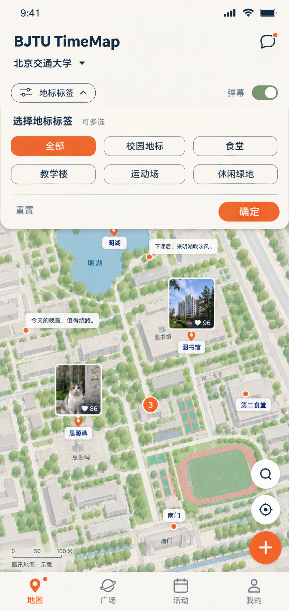

# 地图页面复刻说明

> 2026-11-05 后续调整：按用户要求，前端已回退到本轮改造前的版本；下述新界面与交互验证为回退前记录，不代表当前预览。后端、26 点数据和队友维护手册保留。前端改造备份位于 `docs/local/frontend-before-rollback-20261105/`（不提交 Git）。

更新日期：2026-11-05。适用模块：地图首页及其筛选、地图覆盖物、校园入口。维护角色：地图前端负责人（待认领）。状态：本地首版已实现并验证，远程尚未上线。实现记录见[本地实施与验证记录](../../test/地图分级与地点数据本地实施记录-2026-11-05.md)。

## 1. 依据与本次范围

以用户提供的《坐标地图页面.png》为视觉依据，以[校园地点分类资料](../BJTUTimeMap_校园地点分类资料.md)为地点依据，以[地图地标显示层级实现方案](地图地标显示层级实现方案.md)为缩放与避让规则。

本次目标是复刻图中的布局、筛选面板、照片／文字覆盖物和地图工具，并加入校园总入口及具体地点三级渐进展示。参考图只证明“筛选展开时”的静态外观；默认是否展开、点击行为、弹幕运动、数字含义等采用下文产品规则，不能当成截图已证明的行为。

本次决定优先于旧地图方案中冲突的内容：

- 使用“校园地标、食堂、教学楼、运动场、休闲场所”五类；“全部”是筛选操作。
- 使用独立校园入口＋具体地点一级／二级／三级，不要求新增教学区、生活区等区域节点。
- 用户已确认去掉茅以升坐像、郑振铎铜像、留园，地点总数为 26；校园总入口另计。
- 相邻地点按“主体先出现、细节后出现”分级，学活食堂、银杏大道改为三级；三级数量为 6／11／9，保持三级具体地点。
- 地点样式按本图采用“图钉／圆点＋独立白底名称”，替代旧方案的统一横向图标名称组合。
- 本图照片默认展示单张精选预览；多帖叠层与多帖展开面板不作为本轮复刻的必需项。点击照片直接进入该帖详情，点击地点名称／图钉进入地点抽屉。

[旧地图帖子展示说明](地图帖子展示UI优化与实现说明.md)仅作既有能力与历史决策参考；本文不改变地点详情内部内容和帖子详情自身交互。

## 2. 页面结构与初始状态

从上到下：系统安全区 → 品牌与学校栏 → 标签／弹幕工具栏 → 地图 → 底部四项导航。标签展开面板覆盖在地图上方，不推挤地图容器；底图中心与缩放保持不变。

首次进入默认收起标签面板，分类为“全部”，地图拟合全校范围，显示一级地点；截图验收另设“标签面板展开”状态。返回地图保留本次会话的分类、弹幕偏好、中心与缩放。校园周边远景只显示校园总入口；从校园介绍点击“进入校园地图”后拟合校园范围。

| 区域 | 内容 | 行为 |
| --- | --- | --- |
| 品牌栏 | `BJTU TimeMap`，右侧消息气泡 | 消息进入现有消息页；未读圆点由真实未读状态驱动 |
| 学校栏 | 北京交通大学＋下拉箭头 | 进入现有学校／地点选择流程；只有一所学校时仍显示真实名称，不伪造可选学校 |
| 工具栏左侧 | 调节图标、地标标签、方向箭头 | 点击展开／收起分类面板，箭头同步变化 |
| 工具栏右侧 | 弹幕＋开关 | 只控制文字弹幕，不隐藏地点、照片或贴纸 |
| 地图层 | 地点、精选照片、贴纸、文字弹幕、聚合点 | 内容按层级、筛选、视口和避让决定是否出现 |
| 右下工具 | 搜索、定位、橙色发布按钮 | 上下排列；沿用真实搜索、定位权限和发帖流程 |
| 左下角 | SDK 标识、版权、比例尺 | 保留地图服务要求的标识；不遮挡、不伪造为截图中的固定比例 |
| 底部导航 | 地图、广场、活动、我的 | 当前地图为橙色；沿用现有路由与切换能力 |

顶部学校名称来自学校数据；地图校园入口来自经维护的校园节点，两者用途不同。截图中的“9:41”、信号和电池属于系统状态栏，Web 页面不绘制虚假系统 UI。

## 3. 视觉与响应式规格

原图为 864×1821 像素，不能直接把截图像素作为 CSS px。以约 390px 宽手机为首轮布局基准，按视觉比例还原，再验证 320／375／390／430px 宽与桌面居中容器。以下为调试起点，并非截图精确测量结果。

| 元素 | 建议规格 |
| --- | --- |
| 背景与文字 | 暖米白、深蓝文字；优先沿用 `tokens.css` 和 [UI 规范](../UI设计规范.md) |
| 标题 | 26–30px、粗体；学校名称 17–19px |
| 水平边距 | 16–20px；工具栏与面板内容左右对齐 |
| 标签入口 | 胶囊描边，视觉高约 32–36px，实际触控区至少 44px |
| 弹幕开关 | 约 40×24px；开启灰绿底＋白圆钮，关闭灰色；另补足触控区 |
| 面板 | 暖白不透明背景，下角约 20–24px 圆角，轻阴影，无全屏深色遮罩 |
| 面板标题 | “选择地标标签”16–18px，右侧“可多选”13–14px |
| 分类按钮 | 三列两行，列间距 10–12px、行间距 10px；高约 40px，圆角 10–12px |
| 选中分类 | 橙色填充＋白字；未选中为暖白／透明底、蓝灰描边和深蓝字 |
| 底部操作 | 细分隔线；左“重置”，右胶囊“确定”，至少 44px 触控高 |
| 地点名称 | 白底小圆角、12–14px 深蓝字、轻阴影；长名省略，详情显示全名 |
| 照片卡 | 约 60–72px 宽、72–88px 高，白边 2px、圆角 6–8px、轻阴影 |
| 点赞角标 | 图片右下局部深色衬底＋白色心形与真实点赞数，不把整张图压暗 |
| 文字气泡 | 白底、深色 12–14px 字、最多两行；优先保证可读性 |
| 地图工具 | 搜索／定位约 44–48px 圆形，发布约 52px；间隔 8–12px |
| 底部导航 | 图标＋标签；高度约 56px，另加底部安全区 |

截图中的亮橙可用于图钉与装饰；普通字号白字按钮使用现有操作橙，避免为了取色降低文字对比度。默认沿用系统字体，不引入截图中无法确认授权的字体。

面板高度随内容变化，不能按截图固定为屏幕比例。矮屏／大字体时面板内容滚动，操作栏保持可达，地图仍保留可辨区域；三列按钮放不下时改两列，不压缩到难以点击。页面主体以 `100dvh`、Shell 和原生安全区协作，避免重复计算状态栏。

## 4. 地标标签多选交互

按钮布局沿用截图，末项按本次命名调整为“休闲场所”：第一行“全部、校园地标、食堂”，第二行“教学楼、运动场、休闲场所”。类别内部含义以分类资料为准。

用 `appliedCategories` 和 `draftCategories` 分开管理已生效值与面板草稿；空集合代表“全部”，不把“全部”存入地点数据。

1. 展开时复制已生效筛选到草稿；仅改变草稿，不立刻刷新地图。
2. 点击具体类别可选／取消，多个类别之间按 OR 查询；选中具体类别后“全部”退出选中。
3. 点击“全部”清空草稿；全部具体类别都取消时也回到“全部”。
4. “重置”只把草稿恢复为“全部”，仍需“确定”提交。
5. “确定”原子提交草稿、收起面板，并应用地图结果；分类请求失败保留已选值并显示重试。
6. 点击标签入口、面板外地图或系统返回收起时放弃未确认修改，恢复已生效值；外部点击不同时触发地图地点。
7. 打开搜索或地点／校园抽屉时关闭筛选，避免多个面板相互遮挡。筛选区操作不向底图传播拖拽事件。

筛选不改变地点本身的类别或显示级别。非“全部”时突破默认级别，优先让当前视野内符合类别的地点成为候选；最终仍避让／聚合。校园周边远景下分类生效时隐藏校园总入口，用筛选结果及其聚合表达结果，避免出现“筛了食堂只剩学校”的情况。

## 5. 地图内容与点击目标

### 5.1 地点和帖子分离

一个具体地点一个业务标记，无帖子也能显示。图钉底端／圆点中心是实际经纬度，照片上沿或名称长度不能改变落点。照片、贴纸、文本各有独立预算，不能因为地点出现就同时展示所有内容。

- 地点图钉／名称：打开现有地点详情抽屉，目标是 `placeId`。
- 照片／贴纸卡：进入对应帖子详情，目标是 `postId`；返回恢复视角。
- 聚合数字：表示参与聚合的不同地点数量；点击放大至成员范围，到最大缩放仍重叠则打开地点列表。
- 点赞角标：首版只读展示该预览帖的点赞数，不单独提交点赞；不把点赞量当帖子数或地点数。
- 透明贴纸：保持 alpha、使用 contain，不套照片裁切背景；只用真实已发布媒体。

图中的“第二食堂、思源碑”并非当前 26 个地点的规范名称，不能为追求画面一致而新增或擅自映射。“第二食堂”不自动等于“学四食堂”，“思源碑”不自动等于“知行校训碑”；实装使用资料中的名称、ID 和坐标。示例猫图、楼图、96／86 点赞及文案不写成生产固定内容。

### 5.2 弹幕

静态截图只能确认有地理锚定气泡，不能确认滚动。首版建议采用地理锚定、分批轮换的文字弹幕：仅从当前有效视野中、有效具体地点下、当前用户可见的公开纯文字帖取候选。

建议初始最多同时 2 条，每条停留约 6 秒后淡出换下一条；可点击打开原帖。拖动、缩放时暂停轮换，结束后重新计算；退出页面、后台、打开筛选或详情抽屉时暂停。开关关闭后立即清除气泡并停止调度；遵循减少动效偏好，改静态替换。候选读取失败时地点和图片保持可用，提示文字内容暂不可用，不伪造弹幕。

这是本次拟定交互，后续若要求横向滚动，需另行定义轨道与碰撞，不能用一条 CSS 滚动动画代替视野候选管理。

## 6. 校园总入口

校园总入口“北京交通大学”独立于 26 个具体地点。普通校园周边远景只展示该入口；进入全校概览后隐藏入口，按 6／11／9 三级累计显示具体地点。

点击入口升起校园介绍抽屉：学校名称、简介、相关照片、“进入校园地图”按钮。无照片显示空态，不抓取无来源示例图；按钮按有效校园边界拟合地图，预留头部／底部工具遮挡空间，关闭抽屉后显示一级地点。若已有校园简介页可复用内容读取与组件，但需补全真实校园节点数据。

校园总入口不进入发布地点选择器；深链、接口提交也须拒绝其作为发帖地点。聚合数字是临时可视分组，也不能发帖。校园相关内容通过维护的简介和照片承载，不需要创建“北京交通大学”普通帖子来填充。

## 7. 底图与叠放顺序

先沿用腾讯／高德／Leaflet 在线底图能力，使用可用浅色样式。参考图的树冠、水彩建筑阴影属于美术底图，不是只改 CSS 就能复刻的效果。如追求同等插画风格，另需干净图稿、授权、控制点和坐标校准；不能直接用包含 UI 的整张截图作可交互底图。

业务层从低到高为：底图与原有地名 → 普通地点／聚合 → 精选卡片与文字 → 选中地点 → 地图工具 → 筛选／搜索 → 地点或校园抽屉 → 权限弹窗。具体 z-index 应整合现有 stacking context，不能只给每个 SDK 子元素添加更大的数字。版权与比例尺始终可见，卡片必须避开头部、面板、右侧工具和底部导航。

## 8. 仓库改造位置

以下是 2026-11-05 本地源码核对结果，不代表线上部署状态。

| 位置（仓库相对路径） | 已有基础 | 拟改造 |
| --- | --- | --- |
| `app/src/screens/MapScreen.tsx`、`map.css` | 标题、横向单选筛选、搜索／定位／发布、地点抽屉 | 多选面板、弹幕控制、分级候选与校园入口协调 |
| `app/src/components/TabBar.tsx`、`tabbar.css` | 已有地图／广场／活动／我的 | 仅按图微调视觉，共享导航回归检查 |
| `app/src/native/mapApi.ts` | 中心、zoom、project／unproject、选中及尺寸能力 | 追加视图订阅、边界与覆盖物更新约定 |
| `TencentMap.tsx`／`AmapMap.tsx`／`RealMap.tsx`、`realmaps.css`（均在 `app/src/native/`） | 在线标记、卡片、点击分流 | 统一覆盖物模板、增量更新、同一避让策略 |
| `app/src/api/client.ts` | 地点与学校读取；地图层级读取仅取四个字段 | 增加完整地图 DTO、多分类读取与分级字段 |
| `server/src/mapRoutes.ts` | `/api/map/places` 和 `/api/map/posts` | 扩展分级与多分类契约，提供完整候选和弹幕数据 |
| `server/src/placeCategories.ts`、地点管理与发布校验 | 现有五类为旧命名 | 同步新分类，保护非发帖节点 |

当前地图首页仍用 `listPlaces` 结合帖子列表构造标记；已有专用地图接口不等于首页已接入。具体数据迁移、参数和渐进展示算法统一见[实现方案](地图地标显示层级实现方案.md)，实施顺序与交付条件见[执行方案](地点数据与地图改造执行方案.md)。

## 9. 交付顺序与验收

实施顺序：先完成分类／分级数据契约，再完成静态头部与面板，随后接入缩放及避让、精选卡片、校园介绍和文字弹幕，最后实机调整。

| 场景 | 验收标准 |
| --- | --- |
| 截图复刻 | 展开态结构、按钮顺序、色彩与照片布局接近参考；允许真实底图与地点数据不同 |
| 多选 | 草稿不立即生效；重置、确定、关闭取消语义一致；两个类别结果按并集 |
| 分层 | 普通概览／局部／近景候选累计为 6／17／26，碰撞后实际可少于候选数 |
| 搜索 | 可搜到三级地点；选择后定位、高亮、显示名称并打开详情，关闭后正确恢复 |
| 校园入口 | 周边可见、校内隐藏；介绍与进入按钮可用；不能用于发帖 |
| 卡片 | 图钉点地点、图片点帖子；真实内容、点赞、透明贴纸均正确 |
| 工具与返回 | 定位拒绝／超时有恢复入口；发布回地图聚焦具体地点；切页返回不跳回默认中心 |
| 异常 | 空分类、地点失败、帖子失败、SDK 降级和离线分别有反馈 |
| 小屏与无障碍 | 320px 无横向溢出，安全区不重叠；键盘焦点、开关状态、按钮选中状态可感知 |

使用截图对比时固定视口、有效数据与可用底图；实际实现完成后再记录设备、provider、缩放配置和验收证据，本文不预先宣称已通过。
