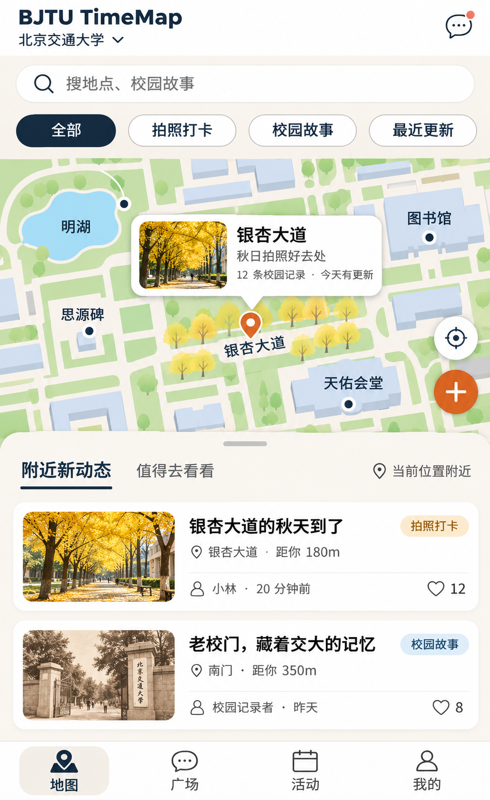
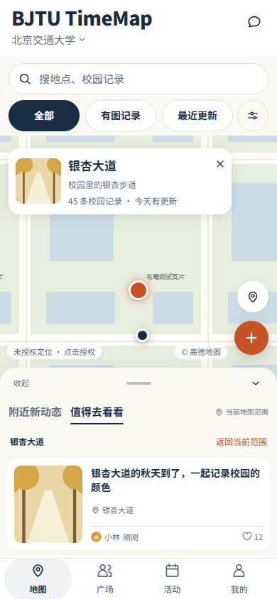

# 地图页第一批功能与 UI 修改文档

日期：2026-11-20。2026-11-21 更新：完整改版曾实施后回退；现按用户最新要求完成保留地图原貌的细节版。当前实际范围见第 13 节，第 12 节为完整试版的历史记录。

回退范围：恢复 `MapScreen.tsx` 改版前的界面及交互入口，停用发现面板和三个用途筛选；设计稿、独立实现模块及只读查询接口保留，便于后续调整。保留栅格地图的动画/销毁清理修复，消息页及其他页面未回退，远程数据库未变更。

2026-11-21 方案补充：由于当前普通帖子没有用途标签，后续讨论改为由管理员维护校园故事与拍照打卡指南，并关联现有地点。分类数据来源以[管理员内容维护方案](2026-11-21-admin-content-maintenance.md)第 7 节为准；本文件第 3.2、6 节的帖子主题字段是早期备选方案，不再作为当前实施要求。在维护能力完成前，地图可先提供「全部 / 有图记录 / 最近更新」。

## 1. 修改目标与范围

用户反馈现有地图缺少浏览和使用动机。本次将地图页调整为校园内容的发现入口，让用户能直接回答三个问题：附近有什么新内容、哪个地点值得去、点开地点能看到什么。

第一批仅实现已经确认的三项功能：

1. 用途筛选：全部、拍照打卡、校园故事、最近更新。
2. 地点卡片：展示地点看点、校园记录数量与更新时间。
3. 底部可拖动内容面板：浏览附近新动态或值得去看的内容，并与地图联动。

保留现有学校选择、消息入口、定位、发布和四项底部导航。时光对比、漫游路线、个人足迹属于后续方向，不纳入本次范围。

本文最初为设计方案，后续已按用户要求实施第一版。原始方案与实际阶段差异见第 12 节。

## 2. 设计依据

以本次生成的[地图页示意图](assets/map-discovery-reference.png)作为视觉对照。

图中的地图形状、照片、地点位置、距离、条数、作者和时间均为示意内容。正式版本继续使用现有地图 SDK 与真实地点坐标，不将示意地图作为实际底图，也不写入示例帖子或虚构计数。保留地图服务商要求的标识和归属信息，不能让底部面板覆盖这些信息。

## 3. 页面结构

自上而下为：品牌与学校栏 → 搜索框 → 用途筛选 → 地图与选中地点卡片 → 可拖动内容面板 → 固定底部导航。

### 3.1 顶部栏与搜索

- 左侧保留 `BJTU TimeMap`，下方为当前学校和下拉箭头；右侧保留消息入口，未读提示沿用真实消息状态。
- 搜索入口由悬浮图标调整为常驻搜索框，提示文字为「搜地点、校园故事」。
- 输入后展示按「地点」「校园记录」分组的结果。点地点定位并打开地点内容，点记录打开帖子详情；清空输入恢复之前的地图浏览状态。
- 地点和帖子均在服务端搜索，不能仅搜索首屏已加载的数据。没有全文检索能力时，先支持地点名称与帖子正文关键词匹配，不对用户承诺语义搜索。
- 输入防抖约 300ms，取消或忽略过期请求，避免旧结果覆盖新关键词；展示加载、无结果、失败和重试。

### 3.2 用途筛选

| 入口 | 含义 | 选择后的效果 |
| --- | --- | --- |
| 全部 | 当前地理范围内的全部有效校园记录 | 恢复默认内容和地图标记 |
| 拍照打卡 | 明确标注为拍照打卡主题的记录 | 地图突出有匹配记录的地点，面板仅列匹配内容 |
| 校园故事 | 明确标注为校园故事主题的记录 | 同步过滤地点与面板内容 |
| 最近更新 | 服务端当前时间向前 7 天发布的记录 | 按发布时间倒序，地点显示近期更新状态 |

四项为单选按钮，默认「全部」；选中项使用深蓝底白字，其他项为白底细描边。原「地标标签」表达的是地点类型，本次用途筛选表达的是内容用途，两者不能直接视为同一个字段。已有地点分类能力可保留在搜索筛选中，不再占用首页唯一主要入口。

拍照打卡和校园故事需要可信主题数据。建议增加受控主题字段 `photo_checkin` / `campus_story`，一条帖子可有多个主题，缺省为空。历史数据可由管理员补标，不能仅凭地点名或正文关键词自动断言主题。主题写入、管理员补标的具体入口在实施时接入现有发布和内容管理流程；无主题的记录仍可出现在「全部」及符合时间条件的「最近更新」中。

### 3.3 地图展示与地点卡片

- 普通地点使用小尺寸统一标记；选中地点使用橙色高亮标记，避免全屏同样醒目的红色图钉。
- 缩小时按地图 SDK 的聚合能力合并邻近地点；放大后再显示具体地点。碰撞时优先保证选中地点可见，不能为显示更多卡片而遮挡选中内容。
- 默认不为所有地点同时展示大图卡片。用户点击地点后，仅展示该地点的摘要卡。
- 摘要卡包含封面、地点名称、短看点、有效记录数量、最后更新时间。字段分别来源于真实地点/帖子数据；看点没有维护时可省略，不生成未经确认的事实介绍。
- 代表封面优先使用符合当前筛选的最新有效图片，没有图片时用统一图片占位。匿名帖封面可正常展示，但不得泄漏匿名作者身份。
- 「今天有更新」只在该地点确有当天有效新记录时显示；日期以统一的 Asia/Shanghai 日界线判断。其他情况显示「昨天更新」或具体日期，无记录时显示「暂无校园记录」。
- 点摘要卡打开既有地点详情。点地图空白区域取消选中，不重置筛选和地图位置。
- 定位和发布按钮置于内容面板上方，随面板高度调整，避免按钮被遮挡。发布成功后沿用既有返回地图并定位新内容的能力。

## 4. 底部内容面板

### 4.1 高度与拖动

面板使用暖白背景、顶部大圆角和居中的拖动条；固定底部导航始终可见。以扣除顶部操作区、安全区及底部导航后的可用高度为基准，提供三种停靠状态：

| 状态 | 建议高度 | 用途 |
| --- | --- | --- |
| 收起 | 约 64–80px，至少显示标题与展开按钮 | 地图优先 |
| 半展开（默认） | 可用高度约 45%，允许首张卡片完整可见 | 地图与内容同时可见 |
| 展开 | 可用高度约 85%，顶部筛选仍可操作 | 集中浏览内容 |

示意图展示半展开状态。短屏和横屏不能强行挤入两张完整卡片；允许面板内滚动。面板到达展开状态后，卡片列表正常滚动，列表位于顶部并继续向下拖动才触发面板收起。拖动开始后超过约 8px 再判为拖拽，避免误触卡片。

提供可点击的展开/收起按钮和可访问名称，不能只支持拖动；支持键盘操作。减少动画偏好开启时降低或取消面板过渡动画。

### 4.2 内容标签与排序

面板顶部有「附近新动态」「值得去看看」两个标签。

- 附近新动态：优先按发布时间倒序，同一时间按稳定 ID 排序。成功取得定位时，默认地理范围为用户位置周边 1km，并展示实际计算距离。
- 值得去看看：优先复用现有校园记录热度规则与近期时间窗，避免新增一套未经说明的推荐算法；同分按发布时间和 ID 稳定排序。具体沿用的后端排序参数在实施记录中注明。
- 两个标签始终叠加当前顶部用途筛选，不得出现地图筛选了校园故事，列表仍显示全部记录的情况。
- 拖动地图后，不自动连续刷新列表。在地图中出现「搜索这片区域」，点击后将内容范围切换为当前可视区域，说明文字改为「当前地图范围」。
- 用户拒绝定位或定位失败时，以当前学校地图可视区域展示内容，说明文字为「当前地图范围」；不展示虚构距离、不写「当前位置附近」。定位失败不阻断地图浏览。
- 仅当服务端确认范围内没有记录时显示空态。附近没有结果时提供「扩大范围」或「查看全校」，需用户主动选择，不静默混入远处内容。

### 4.3 内容卡片

横向卡片左侧图片，右侧标题、地点与距离、作者、时间、点赞数及主题标签。没有自定义标题的帖子使用正文首段短摘要作为标题，不另外生成虚构标题。

作者头像读取本人设置的真实头像，缺失或加载失败时使用既有默认头像；匿名记录严格复用现有匿名姓名及头像规则。无图片记录显示统一占位，图片裁剪保持固定比例、预留尺寸以防布局跳动。

点赞显示服务端计数与本人点赞状态，可复用现有点赞接口和防重复提交处理；计数变化以服务端响应为准，不在失败时假装成功。若暂不提供卡片内点赞操作，必须将图标实现为非交互统计展示。

点击卡片正文打开帖子详情，同时保存来源页的地图中心、缩放、筛选、面板标签、高度、选中地点和列表滚动位置；返回后恢复。点击卡片中的地点信息可定位该地点并选中地图标记，不直接打开帖子；两个点击区域需分开，避免嵌套按钮。

## 5. 地图与面板联动

1. 切换用途筛选：同步更新标记和列表，清除不再匹配的选中卡片；不无故重置用户地图中心。
2. 点击地图标记：高亮地点并显示摘要卡；面板展示该地点的匹配记录，并出现「返回当前范围」入口。没有记录时展示真实空态。
3. 点击面板中的地点：地图平移到对应坐标并高亮；为选中地点留出顶部栏及面板遮挡后的可视空间。普通浏览帖子时不强制地图反复飞行。
4. 点击「返回当前范围」：恢复选点前的范围列表及滚动位置，保留当前用途筛选。
5. 地图移动后：只更新可视提示，点击「搜索这片区域」才提交新的范围查询；定位按钮明确回到用户位置，学校切换明确重置到新学校范围。
6. 请求竞态：以查询参数或请求序号识别响应，过期结果不得覆盖新学校、新筛选或新范围的数据。

## 6. 数据与接口要求

当前项目已有真实地图、地点及帖子接口，地图页已有地点搜索与地点详情面板。实施时先复用并整理这些能力；本节是增量契约要求，不表示这些新增字段已经存在。

| 能力 | 服务端要求 |
| --- | --- |
| 内容查询 | 支持学校/校区、地理范围或中心点与半径、用途主题、7 天更新窗口、排序、游标和条数限制 |
| 地点聚合 | 返回符合当前筛选的地点、坐标、有效记录总数、最后发布时间、代表封面；计数不能来自客户端首屏数组长度 |
| 地点摘要 | 提供可选短介绍；没有内容时允许为空，不以生成文案冒充管理员维护数据 |
| 搜索 | 地点名称与帖子正文搜索，分组结果；支持取消/忽略旧查询 |
| 分页 | 建议每页 20 条，稳定游标，返回是否有更多；移动地图或换筛选后不能拼接旧范围结果 |
| 权限 | 仅返回调用者有权查看且正常发布的内容；复用现有下架、删除、匿名及媒体访问控制 |
| 距离 | 基于真实坐标计算；定位缺失时距离为空，不能以地图中心距离冒充「距你」 |

客户端可以做展示格式化和标记碰撞处理，不能凭当前已加载的少量帖子推算全量数量、完整搜索结果或全校推荐排序。新增接口及受控主题字段需要同步修改前后端类型、数据库迁移和部署说明。

## 7. 视觉规范

沿用当前深蓝文字、米白背景、白色卡片及橙色发布按钮。建议使用已有全局令牌，新增样式限定在地图发现页内，不影响消息页、广场或其他页面。

| 项目 | 手机 CSS 基准 |
| --- | --- |
| 内容左右边距 | 12–16px |
| 搜索框 | 最小高 44px，圆角约 22px |
| 筛选按钮 | 可见高度约 32–36px，完整触控区域至少 44px |
| 浮层和内容卡片 | 圆角约 14–16px，轻微阴影 |
| 面板顶部圆角 | 20–24px |
| 正文字号 | 14–16px；卡片标题约 16px、加粗 |
| 次级信息 | 12–14px，正常文字对比度至少 4.5:1 |
| 图标 | 统一 SVG 体系，不用表情替代操作图标 |

按设备高度自适应地图与面板比例，不将整张示意图当作固定尺寸页面。学校名、长标题、中文输入法、系统字体放大和原生安全区均需检查；地理范围及距离展示规则不随视觉布局变化。

## 8. 状态与反馈

- 初次加载：地图仍可交互，面板展示骨架，加载结束后保持当前面板高度。
- 部分失败：地点成功、记录失败时保留可用地图，内容区域提示失败并允许重试，不能把网络错误说成「暂无内容」。
- 无数据：说明当前范围/筛选没有记录，提供清除筛选或扩大范围。
- 无定位权限：展示当前学校内容和定位说明，不反复弹权限请求，不影响搜索和浏览。
- 图片失败：固定占位，不挤压标题和操作区。
- 连续点击/弱网：点赞等写操作有处理中状态，失败可重试；不重复提交。
- 地图 SDK 不可用：明确告知地图加载失败，允许重试；内容列表在接口可用时继续展示，不使用示意底图冒充真实地图。

## 9. 建议实施顺序

1. 核对现有地图查询、热度排序、地点面板及路由恢复逻辑，确认可复用范围。
2. 补充主题、地理内容查询和地点聚合契约；准备具有明确来源的测试夹具。
3. 实现顶部搜索和四个用途筛选，确保地图和面板共用查询状态。
4. 实现单地点摘要卡、面板三档高度、内容标签和分页。
5. 完成地点与内容互相定位、详情返回恢复以及发布后的地图定位回归。
6. 用同宽截图检查视觉还原，执行交互、接口及边界验证后记录实施结果。

## 10. 验收标准

功能必须同时满足：

- 四个筛选可用，数据语义符合第 3.2 节，地图与列表保持一致。
- 选中地点卡片展示真实封面、数量和更新信息；无内容地点不出现虚构数据。
- 面板支持三档停靠、列表滚动与点击展开/收起，底部导航及地图归属信息可见。
- 附近与当前地图范围可区分；拒绝定位时不显示虚构距离。
- 地图选点、面板定位、地点详情与帖子详情跳转完整，返回后恢复来源状态。
- 搜索、分页、失败重试、旧请求忽略、下架过滤及匿名保护均通过验证。

视觉验收可沿用前次 UI 修改的至少 90 分目标：布局层级 35 分、颜色与图标 25 分、字号间距与比例 25 分、状态与响应式 15 分。以同视口截图逐项人工对照，不将人工评分称为像素相似率；真实地图底图、真实用户内容和头像不要求与示意素材相同。

验证尺寸至少包含 375px、390px、430px 和手机横屏；同时检查系统字体放大、减少动画、安全区与键盘弹出。完成前后端构建、相关类型检查、真实查询集成测试和浏览器交互测试。以受控夹具截图，不为视觉验收改动正式数据。

## 11. 后续观察指标

功能上线后再判断效果，不能直接认定新设计会提升使用率。可观察地图页进入帖子/地点详情的比例、首次内容点击耗时、筛选使用率、面板展开率及地图到发布的转化。若记录这些数据，应沿用已有匿名统计机制，避免额外采集用户精确位置轨迹。

## 12. 第一版实施记录（2026-11-21）

### 12.1 实际完成范围

- 顶部改为常驻搜索和「全部 / 有图记录 / 最近更新」三个内容筛选；保留右侧地点类型高级筛选。搜索按地点与校园记录分组，支持防抖、清空和失败重试。
- 正常地图标记改为小圆点；邻近地点在低缩放时聚合显示数量，点击放大。选中地点独立高亮，摘要卡展示真实封面、地点简介、符合筛选的记录数和更新日期；点击摘要进入既有地点详情。
- 新增底部内容面板：默认半展开，可展开、收起至最小，支持拖动和按钮操作；列表滚动与地图手势分离。
- 面板支持最新与推荐排序、地点筛选、按需搜索当前地图区域、失败重试、空态和游标分页。
- 支持真实定位周边 1km 范围；未授权时使用地图范围，不显示“距你”数值。定位提示在本次会话主动拒绝后不反复自动弹出，用户仍可点击定位按钮重新请求。
- 打开帖子前保存筛选、范围、选中地点、面板档位、已加载条数和滚动位置；返回时重新查询并补回之前加载的页，再恢复位置。
- 复用原地点详情抽屉和发布入口；保留地图服务来源提示。修复了栅格地图在筛选、缩放或销毁过程中视图监听器访问已销毁地图的问题。

### 12.2 数据口径

新增只读接口 `GET /api/map/discover`，不增加故事或打卡数据库表，也不新增正式业务内容。支持 `filter`、`sort`、`bounds`、`near`、`placeId`、`schoolId`、`category`、`q`、`limit` 和 `cursor` 参数。范围和筛选在服务端先执行，再统计数量、聚合地点和分页；游标绑定查询条件及查询快照时间。

`photos` 只接受公开正文图片，私人媒体不能让帖子进入有图结果。`recent` 使用服务端快照时间向前 7 天。公开结果排除停用地点和下架帖子，复用匿名作者遮罩和当前用户头像字段。

「值得去看看」沿用现有地图内容排序的主要规则：近 30 天记录优先，再按点赞数、发布时间和稳定 ID 排序；采用快照游标避免翻页期间新内容挤入造成重复。它不等同于广场使用的点击率推荐模型，界面未宣称个性化推荐。

历史记录缺少学校/校区归属时，不为其编造归属；当前学校的区域浏览仍由真实地图地理范围限制。多学校跨校选择及历史归属补全未在本轮扩展。

### 12.3 与示意图的阶段差异

- 校园故事、拍照打卡指南需要管理员维护能力，第一版不显示这两个用途入口，不依靠关键词猜测。具体维护方案见[管理员内容维护文档](2026-11-21-admin-content-maintenance.md)。
- 地图继续使用真实 SDK/栅格适配器，不替换为示意图中的插画底图。聚合在共享标记层执行，以兼容各适配器；不是依赖某一家 SDK 的聚合插件。
- 面板收起为约 88px，以容纳展开、收起按钮的触控区域；短屏和横屏动态调整高度，不保证固定显示两张完整卡片。
- 卡片内点赞暂为统计展示，实际点赞继续在帖子详情完成。
- 不扩展管理员维护后台，不加入活动新筛选、时光对比、路线或足迹。

### 12.4 验证与截图

- 前端 `npm run build`、服务端 `npm run typecheck` 与 `npm run build` 通过。前端构建仍有大体积 JS chunk 提醒。
- `server/tests/map-discovery.test.ts`：在独立本机 PostgreSQL schema 中验证全量计数、有图/近期筛选、地理范围、附近距离范围、搜索、分页及游标校验、推荐排序、匿名/头像规则、停用地点与下架过滤、私人图片排除。
- `tools/checks/map-discovery-browser.mjs`：使用受控 API、封面及测试瓦片，验证聚合点放大、筛选切换和旧响应忽略、地点选择、分页失败重试、三档面板（含按钮最小化）、帖子返回后恢复已加载页及滚动、搜索分组、空态、失败重试、减少动画和放大文字；同时通过正常动画下缩放期间切换筛选的回归验证。
- 浏览器布局覆盖 375px、390px、430px 与横屏，无横向溢出。截图是功能及布局验收材料，不代表正式地图、真实活动或真实帖子数据。本次没有重新计算人工还原百分比，也未执行正式服务部署或 Android 真机验收。

实现截图：[390px](assets/map-discovery-implemented-390.png)、[选中地点](assets/map-discovery-selected.png)、[375px](assets/map-discovery-implemented-375.png)、[430px](assets/map-discovery-implemented-430.png)、[横屏](assets/map-discovery-implemented-844.png)。

### 12.5 主要文件与发布要求

前端：`MapScreen.tsx`、`MapDiscovery.tsx`、`mapdiscovery.css`、`api/mapDiscovery.ts`；栅格适配器清理逻辑位于 `native/RealMap.tsx`。服务端：`mapDiscovery.ts`，由现有 `mapRoutes.ts` 注册。

本轮无需新增数据库迁移，但依赖现有帖子、媒体、地点和校区字段。发布时需要同时更新前后端，确保新接口可用；只更新前端会出现内容加载失败。当前工作区尚未部署到正式服务。

## 13. 最新细节版：保留地图原貌（2026-11-21）

本节覆盖前述试版中与用户最新要求冲突的部分。

### 13.1 当前布局与边界

- 原有「地标标签」按钮保留，在右侧增加「拍照打卡」「校园故事」「最近更新」三个胶囊入口；重复点击当前分类取消该选择，恢复附近普通记录。
- 不增加常驻搜索框，不替换原有悬浮搜索。地图底图、红色图钉、地标照片卡片、显隐规则和原有地点点击行为沿用当前地图实现。
- 新入口只控制底部内容面板，不替换地图标记数组、不重建地图、不改变地图中心和缩放；原「地标标签」仍按其既有逻辑筛选地图，面板读取相同的地点类别条件。
- 底部面板默认半展开，保留「附近新动态 / 值得去看看」以及真实帖子信息。原地点详情、原搜索面板、地标标签面板或定位说明打开时，内容面板暂时隐藏，避免相互遮挡。

### 13.2 关闭与重新展开

- 面板右上角增加明确的 ×，可完全关闭内容面板，不是仅缩成一个仍占空间的抽屉。
- 顶部拖动条向下拖动超过阈值后完全关闭；列表处于顶部时继续向下拉也可关闭。
- 关闭后地图区域显示「查看附近内容」按钮，可以重新展开；直接点任一顶部新分类也会打开面板。
- 展开、关闭和分类状态分别维护，不改变地图实例及已有标记。面板不参与调整地图容器尺寸。

### 13.3 分类数据的真实状态

「最近更新」复用已实现的地图发现接口，查询近 7 天的真实有效帖子。「附近新动态 / 值得去看看」继续使用真实帖子查询和排序。

管理员故事与打卡指南维护能力尚未实施，因此这两个入口目前展示「校园故事正在整理中」「拍照打卡地正在整理中」，不请求不存在的分类接口、不把所有带图帖子归为打卡、不依据关键词猜故事。后续按[管理员维护方案](2026-11-21-admin-content-maintenance.md)接入正式内容。

### 13.4 验证与文件

前端构建通过。`tools/checks/map-discovery-lite-browser.mjs` 验证：

- 地标标签保留在左侧，三个入口位于其右侧。
- 地标卡片仍保持原有 66px 图片和照片卡片样式，不出现先前试版的聚合圆点。
- 分类切换及关闭面板前后，原地图实例和地标 ID 集合保持不变。
- 两个待维护分类不展示普通帖子冒充整理内容，最近更新确实请求 `recent` 筛选。
- × 关闭、下拉关闭、重新展开、原地标标签弹层互斥和读取失败重试通过。
- 检查 375px、390px、430px 与横屏，无页面横向溢出。截图使用测试瓦片、测试封面和测试帖子，不写入远程数据库。

截图：[390px 展开](assets/map-discovery-lite-open-390.png)、[390px 关闭](assets/map-discovery-lite-closed-390.png)、[375px](assets/map-discovery-lite-open-375.png)、[430px](assets/map-discovery-lite-open-430.png)、[横屏](assets/map-discovery-lite-open-844.png)。

主要文件：`MapScreen.tsx` 仅增加工具栏入口和独立内容面板；`MapDiscovery.tsx` 的 `passiveMap` 模式禁止面板修改地图；`mapdiscovery-lite.css` 仅提供新增按钮和面板样式，不覆盖 `.rm` 地标样式。此版不修改服务端或执行远程数据库迁移。

## 14. 热门排序与文字封面补充（2026-11-21）

本节更新第 12、13 节中原「值得去看看」的规则。

- 第二个排序入口改名为「附近热门」。附近新动态仍按发布时间倒序；附近热门严格限定近 7 天，并按 `点赞数×2 + 有效评论数×3 + 收藏数 − max(0, 距发布小时数−24)` 降序排列，同分再按发布时间及 ID 稳定排序。下架评论不计入热度，超过 7 天的高赞旧帖不补入热门。
- 热度的时间衰减以查询快照时间计算，游标携带热度分数并绑定查询条件。更改排序后旧游标不能继续使用。面板在热门模式下显示「近 7 天 · 按点赞、评论、收藏热度排序」。
- 纯文字帖封面改为广场与附近列表共用 `PostTextCover` 组件。同一帖子 ID 使用相同的便签纸色、胶带、纹理、字体和正文；附近列表仅做紧凑缩略展示，不再以「校园记录」定位占位图代替文字封面。带图帖继续使用帖子图片，图片加载失败与纯文字帖子保持不同处理。

新增共用文件为 `components/PostTextCover.tsx`、`components/posttextcover.css` 和 `data/textCover.ts`；广场的 `CampusPostCard.tsx` 与地图面板共同调用。原便签样式从 `campus-reference.css` 移入共用样式文件，保持广场原本的便签效果。

验证记录：前后端构建、服务端类型检查、地图发现 SQL 集成测试及细节版浏览器测试通过。SQL 测试覆盖评论与收藏参与热度、旧高赞记录排除、时间顺序与热度顺序不同，以及热度分页；浏览器测试对比同一纯文字帖在广场和附近列表中的背景色、纹理、字体及正文一致。

已重启本机开发网关以加载新排序，仍连接原远程数据库，未执行远程迁移或正式部署。重启后只读检查确认普通查询有 36 条、近 7 天热门有 13 条（该计数仅是验证时的实际数据，不作为固定业务值）。前端仍为 `http://127.0.0.1:5180/#/map`。

启动脚本同时补充了失效进程记录的空值和进程名称检查，避免记录中的 PID 被复用时访问空启动时间或误认进程。
