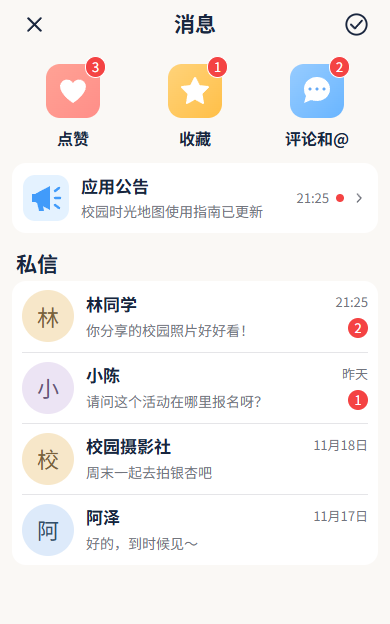

# 消息页 UI 修改文档

日期：2026-11-20。用户确认的视觉还原目标：至少 90%。

## 设计依据

以本次确认的[最终示意图](assets/message-reference.png)为依据。原「聊天」页改为「消息」；独立展示点赞、收藏、评论和 @；删除新增关注、点赞摘要卡和「私信」标题下的说明文字；新增应用公告入口。

## 页面布局与样式

按参考图 993 × 1584 的比例缩放到实际手机 CSS 宽度。390px 视口基准：顶部栏 48px；左右操作区至少 44px；标题约 21px、深蓝加粗。页面底色暖白 #faf8f5，白色卡片，正文深蓝 #19263e，次级文字 #72757e，未读标记珊瑚红 #f44343。

顶部三个等宽入口按「点赞」「收藏」「评论和@」排列；图标容器约 54px，圆角 14px，分别使用浅珊瑚、浅橙、浅蓝渐变和白色 SVG 图标；未读角标在图标右上方，仅真实未读大于零时显示，超过 99 显示 99+。

应用公告位于入口下方，左右边距 12px，白卡片圆角约 14px、最小高 66px。左侧浅蓝喇叭图标，中间标题和最新公告摘要，右侧时间、未读红点及箭头。尚无公告时显示「暂无应用公告」，不能展示示意图里的虚构公告。

「私信」标题约 21px，加粗，标题行距公告 16px；下方没有灰色说明。会话列表为白色圆角卡片，每行最小高 71px；圆形头像约 52px，姓名约 17px，消息摘要和时间约 14px；行内细分隔线，右侧未读角标。真实头像优先，缺失时使用稳定配色的首字头像，不伪造用户。列表仅展示真实私信，不添加示例会话。

整体不加底部导航。保留关闭返回、顶部一键已读。所有文字与消息内容允许系统字体变化；窄屏文本截断，公告正文换行，页面纵向滚动，沿用现有原生安全区。

## 行为及数据

- 点赞、收藏：仅列出别人对本人已发布帖子的有效互动；自己操作不产生通知；取消互动或帖子下架后不继续展示。
- 评论和 @：包含本人帖子的新评论、对本人评论的回复，以及仍有读取权限的会话 @ / @所有人；匿名评论不得泄漏真实姓名或头像。条目点击进入对应帖子或会话。
- 分类页支持查看通知和标记该分类已读；消息首页显示分类未读数。读取采用服务端快照时间，标记已读不能吞掉快照之后的新消息。
- 私信沿用真实会话接口，补充头像和未读数。进入会话并成功加载消息后标记已读；加载失败不能清除未读。
- 应用公告：普通用户查看管理员发布的公告列表和全文；管理中心增加「应用公告」面板，管理员填写标题和正文后发布。服务端验证管理员身份、长度和非空，普通用户不能发布。公告列表、详情、未读提示均读取服务端数据。
- 一键已读覆盖当前快照中的互动、公告和私信，操作失败明确提示。分类、公告、会话均保留加载、空、登录过期、失败重试状态。

## 实施范围

前端消息页、通知分类页、公告列表/详情、管理员发布面板；独立 inbox API 客户端与服务端路由；新增应用公告与阅读进度数据库迁移；消息入口名称统一。保留原群公告路由，应用公告独立建模。

## 验收方法

视觉目标至少 90%：主要结构 35 分（标题、三入口、公告、私信）；颜色图标圆角 25 分；字号间距比例 25 分；未读标记与响应式 15 分。以同宽截图逐项人工核对，不能把未经测量的主观评分报告为像素相似率。示意图的人名、头像及消息内容仅用于测试截图，正式数据来自真实 API。

执行前后端构建/类型检查；浏览器验证有数据、无数据、失败重试、分类跳转、公告全文、标记已读及管理员发布；检查 375px、390px 和横屏布局是否溢出。权限和阅读快照边界须有服务端测试。

## 执行记录

已按文档实现消息首页、互动分类、公告列表/全文、管理员发布面板、数据库迁移 045，以及会话加载成功后同步已读。私信列表继续复用 `/api/threads`，附加信息和通知来自 `/api/inbox`；公告写入使用管理员专属 `/api/admin/announcements`。

最终截图：[390px](assets/message-implemented-390.png)、[375px](assets/message-implemented-375.png)、[横屏](assets/message-implemented-844.png)。截图使用测试夹具，不会写入正式业务数据。

按参考图等比例换算到 390px 后，公告顶部约 161px，实测 162.6px；私信列表顶部约 282px，实测 280.8px；头像目标约 52px，实测 52px；四行私信列表目标约 284px，实测 284px。完整 DOM 几何数据见 [message-layout.json](assets/message-layout.json)。

人工对照评分：结构 35/35，颜色图标圆角 20/25，字号间距比例 22/25，未读与响应式 15/15，合计 **92/100**，达到本文件定义的 90 分验收目标。此分数是本轮人工自检评分，并非自动像素相似率；主要差异为系统字体、头像素材和 SVG 图标细节。正式页面内容随真实数据变化，不承诺每个用户截图都与示意图逐像素相同。

已完成验证：

- `app: npm run build` 通过；构建仍有大体积 JS chunk 提醒。
- `server: npm run typecheck`、`npm run build` 通过。
- `server/tests/inbox.test.ts` 在独立本机 PostgreSQL schema 中通过：真实 SQL 查询、自赞排除、匿名保护、管理员权限、公告发布、成员检查、阅读快照与下架过滤。
- `node tools/checks/inbox-browser.mjs` 通过：三个入口、公告全文/发布、一键已读、空态、失败重试、登录过期，以及 375px / 390px / 横屏无横向溢出；同时验证减少动画、暗色系统偏好下固定浅色页面和 150% 页面缩放。
- 新增前端文件的 Oxlint 无错误，有 4 条 React 建议警告（effect 初始化数据/头像状态与非组件导出）。

测试依赖本机 PostgreSQL，推荐运行方式：设置 `PROFILE_TEST_DATABASE_URL` 指向**本机测试数据库**后，在 server 目录执行 `node --experimental-strip-types tests/inbox.test.ts`。测试创建独立 schema，结束时清理 schema；禁止连接正式数据库。

本次只完成工作区代码、文档和验证，未部署正式服务。上线需同时发布前后端并应用迁移 045，避免新前端请求旧服务上不存在的 inbox API。
